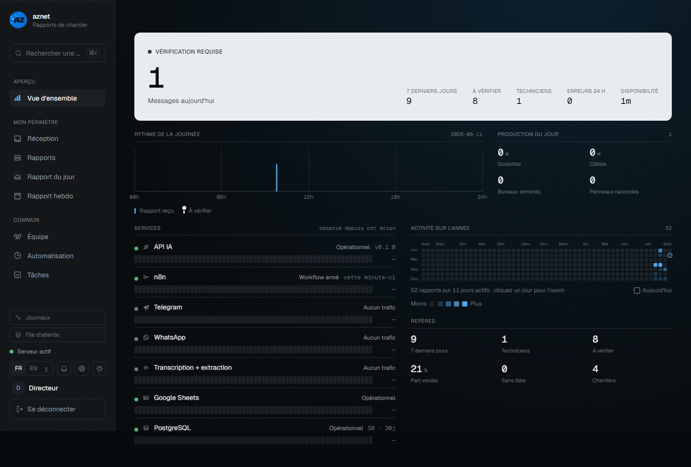
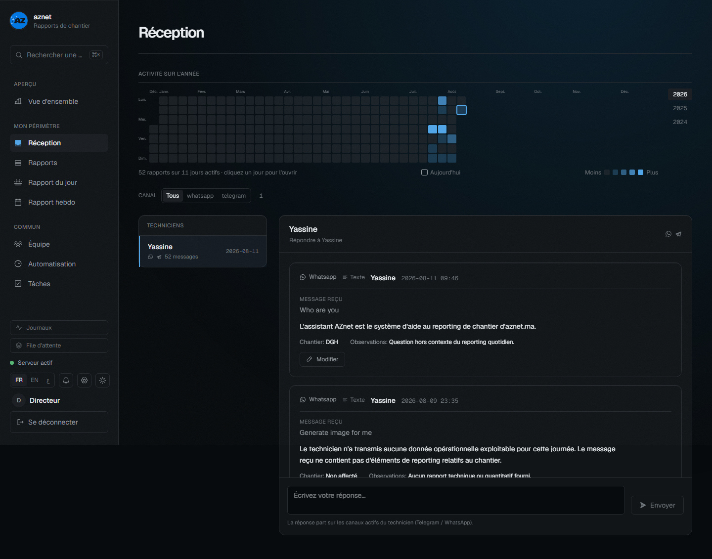
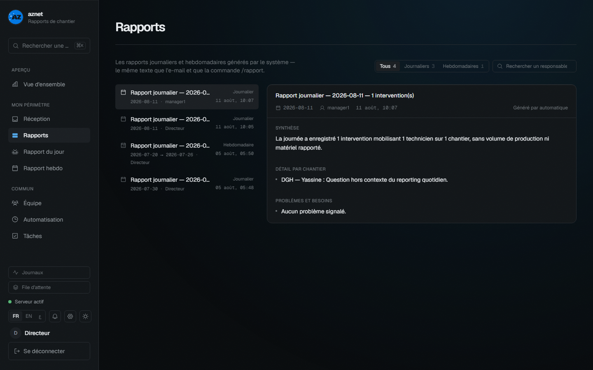
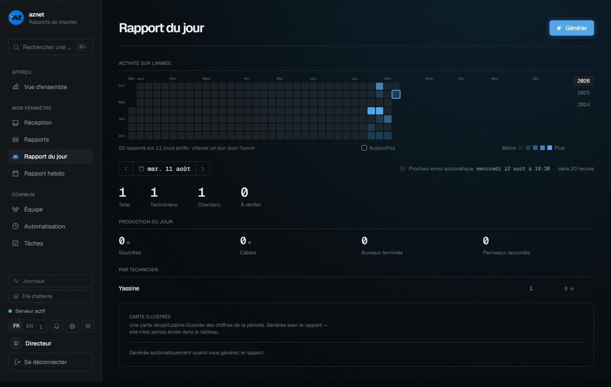
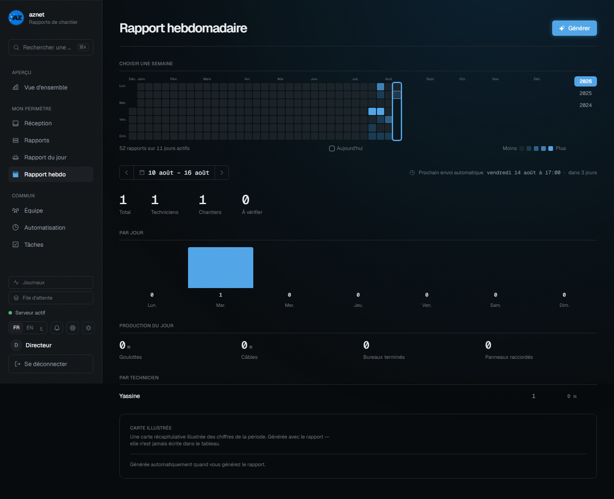
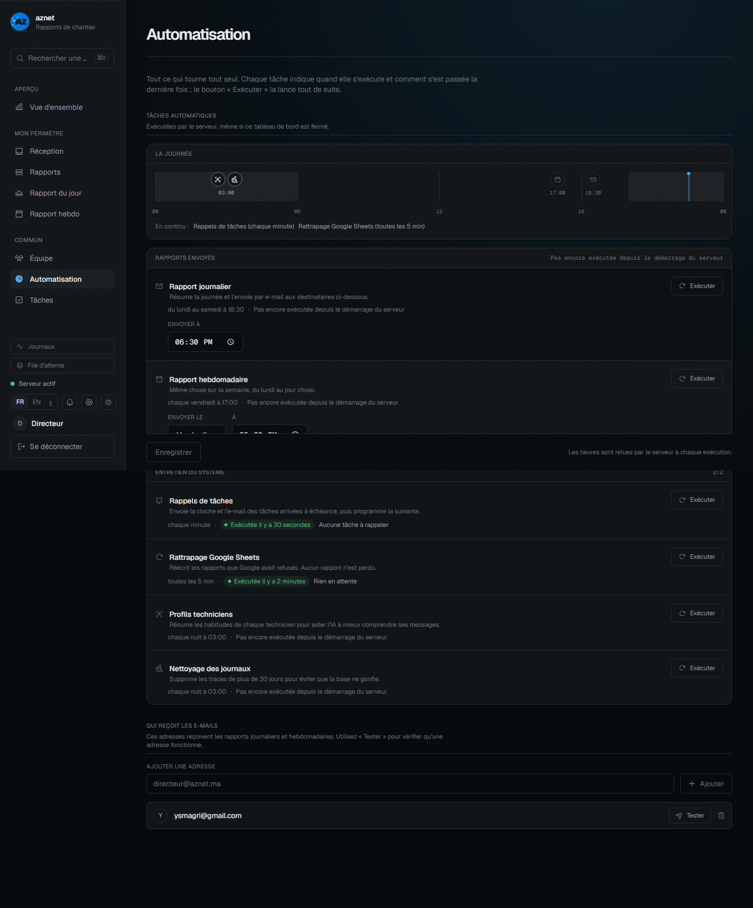
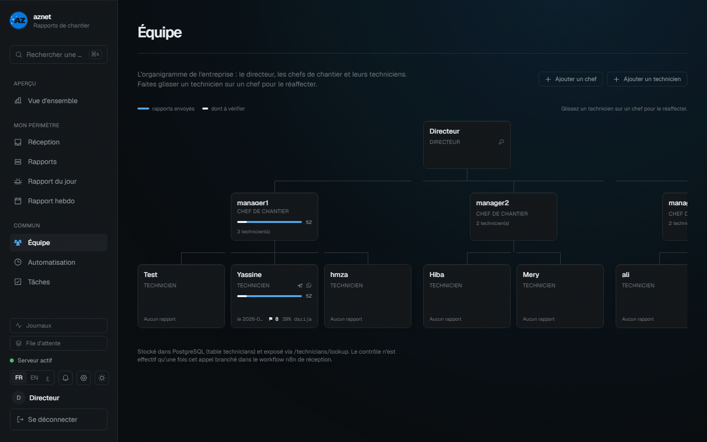
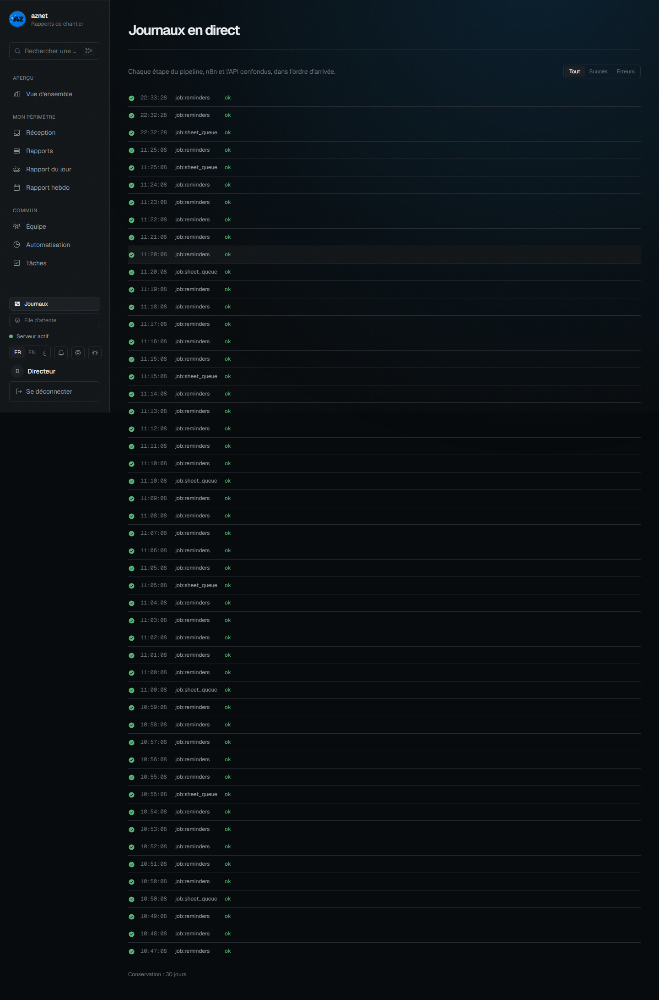
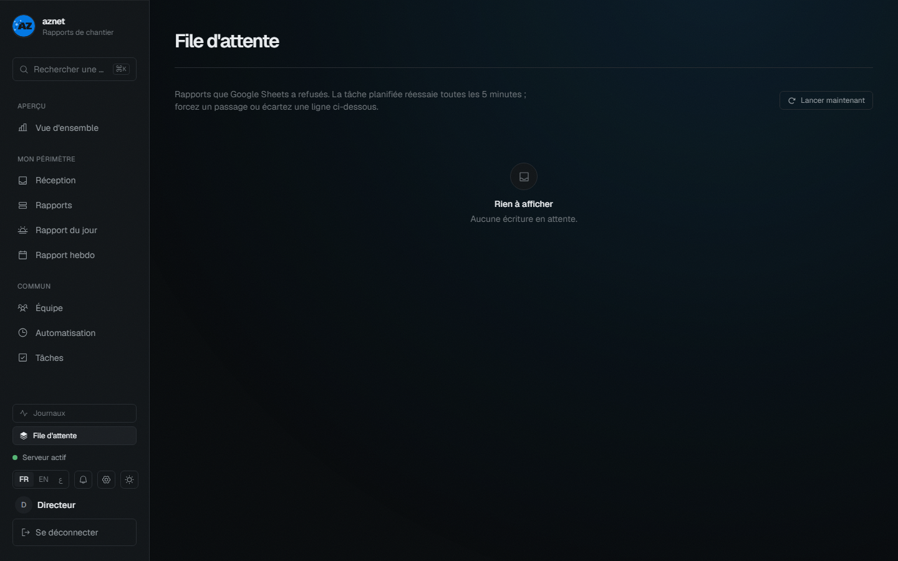
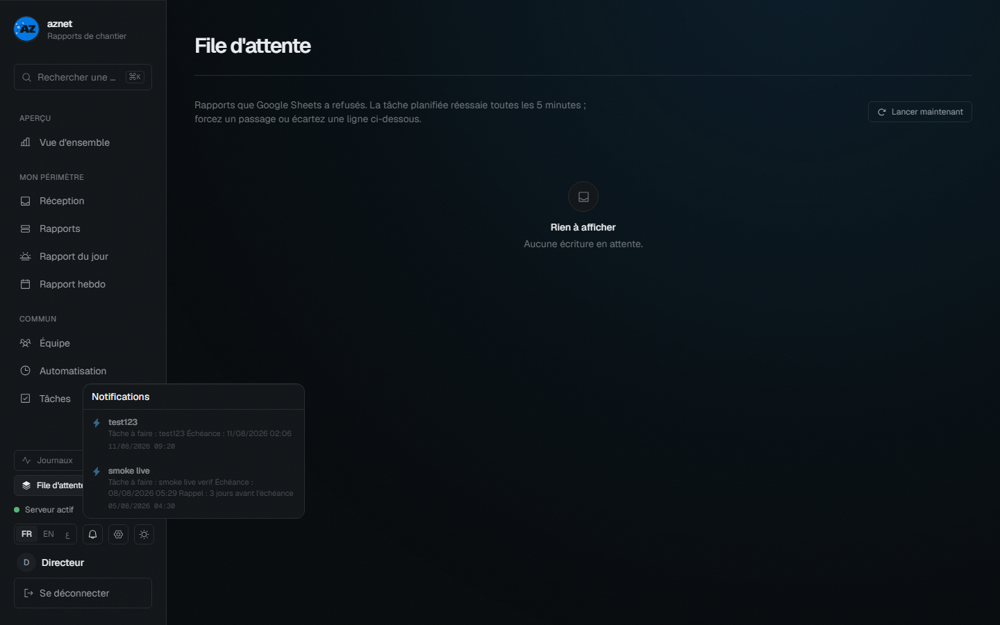

+-------------------------------+-------------------------------+
| { width=8.5cm } | { width=3cm } |
+-------------------------------+-------------------------------+

**ÉCOLE MAROCAINE DES SCIENCES DE L'INGÉNIEUR**

*Membre de Honoris United Universities*

Filière : [À COMPLÉTER — ex. Ingénierie Informatique et Réseaux]

---

**Rapport de Projet de Fin d'Études**

*pour l'obtention du diplôme d'Ingénieur d'État*

# AUTOMATISATION DES RAPPORTS JOURNALIERS DE CHANTIER PAR INTELLIGENCE ARTIFICIELLE

## Transcription de notes vocales en darija et extraction structurée

---

|  |  |
|---|---|
| **Réalisé par** | Yassine [À COMPLÉTER — NOM] |
| **Encadrant académique** | [À COMPLÉTER — NOM] |
| **Encadrant industriel** | [À COMPLÉTER — NOM] |
| **Entreprise d'accueil** | AZNET — Casablanca |
| **Année universitaire** | 2025 / 2026 |
| **Soutenu le** | [À COMPLÉTER — DATE] |

*Membres du jury : [À COMPLÉTER]*

\newpage

# Remerciements

Je tiens tout d'abord à exprimer ma gratitude à mon encadrant académique, [À COMPLÉTER — NOM ENCADRANT ACADÉMIQUE], pour son accompagnement, sa disponibilité et ses conseils méthodologiques tout au long de ce projet de fin d'études.

Je remercie également mon encadrant industriel, [À COMPLÉTER — NOM ENCADRANT INDUSTRIEL], ainsi que l'ensemble de l'équipe d'AZNET, pour leur accueil, leur confiance et le partage de leur expérience du terrain, qui ont permis d'ancrer ce projet dans les besoins réels des équipes de câblage.

Mes remerciements vont aussi au corps professoral de l'EMSI, dont les enseignements ont constitué le socle technique et scientifique de ce travail.

Enfin, je remercie ma famille et mes proches pour leur soutien constant durant l'ensemble de mon cursus.

\newpage

# Résumé

Dans le secteur du câblage réseau, le suivi de l'activité des techniciens repose encore largement sur des comptes rendus oraux ou manuscrits, hétérogènes et difficiles à exploiter. Ce projet de fin d'études, réalisé au sein de l'entreprise AZNET, automatise la production des rapports journaliers de chantier. Le technicien envoie, en fin de journée, une simple note vocale en arabe marocain (darija) — ou une photo de relevé — via Telegram ou WhatsApp ; le système transcrit l'audio, en extrait les données métier typées (mètres de goulotte, de câble préparé et installé, prises bureau, prises panneau, prises testées, mètres de fibre, interconnexions, brins optiques, étages et ailes concernés, stock, remarques), reformule le tout en un résumé professionnel en français, écrit la ligne dans le journal de chantier Google Sheets correspondant et notifie l'encadrement.

L'architecture retenue est hybride : une plateforme d'orchestration low-code (n8n, 65 nœuds) assure la réception multicanale et les intégrations, tandis qu'un microservice développé en Python/FastAPI (66 routes, 8 489 lignes) prend en charge la transcription, l'extraction structurée par grands modèles de langage, la reformulation, la tenue du journal, l'ordonnancement des tâches périodiques et le service du tableau de bord. Un tableau de bord React (11 590 lignes) trilingue français/anglais/arabe complète l'ensemble. La méthodologie suivie est une démarche agile de type Scrum allégé.

Un banc d'essai comparatif de **treize** moteurs de transcription du darija — trois par API et douze en local sur GPU — a été conduit et a renversé l'hypothèse initiale : le moteur retenu n'est pas le service commercial de référence, mais un modèle open-source affiné sur le darija, `BounharAbdelaziz/Morocco-Darija-STT-large`, seul à préserver simultanément les quantités numériques et les emprunts techniques français dont dépend l'intégralité du schéma métier. La chaîne complète, de la note vocale à la réponse de confirmation, est opérationnelle depuis la première semaine du projet. [À COMPLÉTER : résultats chiffrés du pilote en conditions réelles]

**Mots-clés :** reconnaissance vocale, darija, grands modèles de langage, extraction d'information, automatisation de workflows, langue peu dotée.

# Abstract

In the network cabling industry, tracking technicians' daily activity still relies heavily on oral or handwritten reports, which are inconsistent and hard to exploit. This graduation project, carried out at AZNET, automates the production of daily site reports. At the end of the day a technician sends a plain voice note in Moroccan Arabic (Darija) — or a photo of a hand-written tally — through Telegram or WhatsApp; the system transcribes the audio, extracts typed business data (metres of cable tray, of prepared and installed cable, office sockets, patch-panel sockets, tested sockets, metres of fibre, interconnections, optical strands, floors and wings involved, stock, remarks), rewrites everything into a professional French summary, writes the row into the matching Google Sheets site journal, and notifies management.

The chosen architecture is hybrid: a low-code orchestration platform (n8n, 65 nodes) handles multi-channel reception and integrations, while a custom Python/FastAPI microservice (66 routes, 8,489 lines) performs transcription, LLM-based structured extraction, rewriting, journal bookkeeping, job scheduling and dashboard serving. A trilingual French/English/Arabic React dashboard (11,590 lines) completes the system. The project follows a lightweight Scrum methodology.

A comparative benchmark of **thirteen** Darija speech-to-text engines — three via API and twelve locally on GPU — was carried out and overturned the initial hypothesis: the engine finally selected is not the reference commercial service but an open-source Darija fine-tune, `BounharAbdelaziz/Morocco-Darija-STT-large`, the only one preserving both numeric quantities and the French technical loanwords on which the entire business schema depends. The full chain, from voice note to confirmation reply, has been operational since the first week of the project. [TO BE COMPLETED: field-pilot figures]

**Keywords:** speech recognition, Darija, large language models, information extraction, workflow automation, low-resource language.

# ملخص

في قطاع التمديدات الشبكية، لا يزال تتبع النشاط اليومي للتقنيين يعتمد إلى حد كبير على تقارير شفوية أو مكتوبة بخط اليد، غير متجانسة ويصعب استغلالها. يقوم مشروع نهاية الدراسة هذا، المنجز داخل شركة AZNET، بأتمتة إعداد التقارير اليومية للأوراش. يرسل التقني في نهاية اليوم رسالة صوتية بسيطة بالدارجة المغربية — أو صورة لكشف مكتوب بخط اليد — عبر تيليغرام أو واتساب؛ فيقوم النظام بتحويل الصوت إلى نص، واستخراج المعطيات المهنية المصنّفة (أمتار القنوات، الكابلات المحضّرة والمركّبة، مآخذ المكاتب، مآخذ اللوحات، المآخذ المختبرة، أمتار الألياف، الوصلات البينية، الشعيرات البصرية، الطوابق والأجنحة المعنية، المخزون، الملاحظات)، ثم إعادة صياغتها في ملخص مهني بالفرنسية، وتسجيل السطر في دفتر الورش المناسب على Google Sheets وإشعار المسؤولين.

تعتمد البنية المختارة على مقاربة هجينة: منصة أتمتة منخفضة البرمجة (n8n، 65 عقدة) تتكفل بالاستقبال عبر قناتين وبالتكاملات، بينما تتولى خدمة مصغرة مطوّرة بلغة Python/FastAPI (66 مسارًا، 8489 سطرًا) تحويل الصوت إلى نص، والاستخراج المهيكل بواسطة النماذج اللغوية الكبيرة، وإعادة الصياغة، ومسك الدفتر، وجدولة المهام الدورية، وخدمة لوحة القيادة. وتكتمل المنظومة بلوحة قيادة React (11590 سطرًا) بثلاث لغات: الفرنسية والإنجليزية والعربية.

وقد أُجري اختبار مقارن لـ**ثلاثة عشر** محركًا للتعرف على الكلام بالدارجة، ثلاثة عبر واجهات برمجية واثنا عشر محليًا على بطاقة رسومية، فقلب الفرضية الأولية: المحرك المعتمد ليس الخدمة التجارية المرجعية، بل نموذج مفتوح المصدر مُدرَّب على الدارجة، `BounharAbdelaziz/Morocco-Darija-STT-large`، وهو الوحيد الذي يحافظ في آن واحد على الكميات الرقمية وعلى المصطلحات التقنية الفرنسية المقترضة التي يقوم عليها المخطط المهني بأكمله. والسلسلة الكاملة، من الرسالة الصوتية إلى رد التأكيد، تشتغل منذ الأسبوع الأول للمشروع. [يُستكمل: النتائج الرقمية للتجربة الميدانية]

**الكلمات المفاتيح:** التعرف على الكلام، الدارجة، النماذج اللغوية الكبيرة، استخراج المعلومات، أتمتة سير العمل، لغة قليلة الموارد.

\newpage

# Table des matières

Ouvrir dans Word puis appuyer sur F9 pour générer la table des matières.

# Liste des figures

| N° | Titre |
|---|---|
| 3.1 | Architecture générale : les cinq responsabilités et leurs échanges |
| 3.2 | Diagramme de cas d'utilisation |
| 3.3 | Cycle de vie complet d'une note vocale, de l'émission à la ligne du journal, y compris la |
| 3.4 | Cycle de vie d'un rapport, vu comme une machine à états |
| 3.5 | Modèle relationnel |
| 3.6 | Tables d'audit |
| 3.7 | Chaîne de transcription |
| 3.8 | Les quatre chaînes de repli d'extraction |
| 3.9 | Tenue du journal : accumulation intra-journalière et réconciliation de stock |
| 3.10 | Ordonnanceur : six tâches, un fil unique, et une réclamation atomique du droit d'enregistr |
| 3.11 | Workflow d'orchestration : les 65 nœuds regroupés par fonction |
| 3.12 | Workflow, seconde moitié : aiguillage, traitement, réponse au technicien puis journal |
| 3.13 | Contrôle d'accès |
| 4.1 | Topologie de déploiement |
| 4.2 | Démarche du banc d'essai, y compris ses détours |
| 4.3 | Vue d'ensemble — Les repères du jour, le rythme horaire des messages, l'état des sept serv |
| 4.4 | Réception — Le flux des messages entrants, canal par canal, avec le média d'origine et le |
| 4.5 | Rapports — Le miroir plat du journal, filtrable et corrigeable |
| 4.6 | Rapport du jour — Le condensé quotidien tel qu'il part par courriel, avec la possibilité d |
| 4.7 | Rapport hebdomadaire — Le même moteur que le rapport quotidien, appelé sur une plage de da |
| 4.8 | Automatisation — Les six tâches planifiées, leur dernier résultat et leur horaire |
| 4.9 | Équipe — organigramme — Les trois bandes fixes directeur, chefs, techniciens |
| 4.10 | Journaux — La chronologie du pipeline reconstituée par identifiant de corrélation : les ét |
| 4.11 | File d'attente — Les écritures en échec en attente de reprise, avec leur nombre de tentati |
| 4.12 | Notifications — Le centre de notifications, ouvert depuis la barre latérale |

# Liste des tableaux

| N° | Titre |
|---|---|
| 1.1 | Priorisation MoSCoW du périmètre fonctionnel |
| 1.2 | Planning prévisionnel du projet |
| 1.3 | Registre des risques principaux |
| 2.1 | Comparaison des solutions d'orchestration |
| 2.2 | Comparaison des canaux de réception |
| 2.3 | Récapitulatif des choix technologiques |
| 3.1 | Schéma du rapport extrait (`ExtractedReport`) |
| 3.2 | Contrat d'erreurs du service |
| 4.1 | Environnement de développement |
| 4.2 | Comparaison des moteurs accessibles par API |
| 4.3 | Campagne locale complète, 12 moteurs |
| 4.4 | Comportement comparé sur les champs métier |
| 4.5 | Effet de l'invite de vocabulaire en exécution locale |
| 4.6 | État du périmètre livré |
| 4.7 | Métriques du projet |

# Liste des abréviations et acronymes

| Acronyme | Signification |
|---|---|
| API | Application Programming Interface |
| ASR | Automatic Speech Recognition (reconnaissance automatique de la parole) |
| CER | Character Error Rate (taux d'erreur caractère) |
| CSV | Comma-Separated Values |
| CTC | Connectionist Temporal Classification |
| E2E | End-to-End (de bout en bout) |
| FK | Foreign Key (clé étrangère) |
| HTTP | HyperText Transfer Protocol |
| IA | Intelligence Artificielle |
| JSON | JavaScript Object Notation |
| LLM | Large Language Model (grand modèle de langage) |
| LoRA | Low-Rank Adaptation (affinage à faible rang) |
| MSA | Modern Standard Arabic (arabe standard moderne) |
| MVP | Minimum Viable Product (produit minimum viable) |
| ORM | Object-Relational Mapping |
| PFE | Projet de Fin d'Études |
| REST | Representational State Transfer |
| RTL | Right-To-Left (écriture de droite à gauche) |
| SMTP | Simple Mail Transfer Protocol |
| SPA | Single Page Application |
| STT | Speech-To-Text (transcription de la parole en texte) |
| TTL | Time To Live (durée de validité) |
| UML | Unified Modeling Language |
| VRAM | Video Random Access Memory (mémoire de la carte graphique) |
| WABA | WhatsApp Business Account |
| WER | Word Error Rate (taux d'erreur mot) |

\newpage

# Introduction générale

**Contexte.** La transformation numérique des métiers de terrain constitue aujourd'hui un enjeu majeur pour les entreprises de services techniques. Dans le domaine du câblage réseau et des infrastructures informatiques, les équipes passent leurs journées sur les chantiers, loin des outils bureautiques, et la remontée d'information vers l'encadrement reste un maillon faible : les comptes rendus d'activité sont transmis oralement, par messages dispersés ou sur papier, quand ils ne sont pas simplement omis. L'entreprise AZNET, spécialisée dans les infrastructures réseau, souhaite fiabiliser ce processus sans alourdir la charge administrative de ses techniciens, dont la langue de travail naturelle est l'arabe marocain (darija), souvent mêlé de vocabulaire technique français.

**Problématique.** Comment permettre à un technicien de chantier de produire, en moins de deux minutes et sans aucune saisie complexe, un rapport journalier structuré, exploitable par l'encadrement et archivé de manière centralisée ? La difficulté est triple : (1) le canal d'entrée doit être un outil que le technicien utilise déjà — la messagerie instantanée et la note vocale ; (2) la parole spontanée en darija, dialecte peu doté en ressources de reconnaissance vocale, doit être transcrite avec une fiabilité suffisante ; (3) le texte libre obtenu doit être transformé en données structurées normalisées sans invention d'informations.

**Objectifs.** Ce projet vise à concevoir et réaliser une chaîne de traitement complète : réception d'une note vocale ou d'une photo via une messagerie instantanée, transcription automatique du darija, extraction des données métier par grands modèles de langage, reformulation en français professionnel, tenue automatique du journal de chantier dans Google Sheets et notification de l'encadrement. Les choix de moteurs d'intelligence artificielle doivent être justifiés par un banc d'essai comparatif, et l'ensemble doit être réalisé sous une contrainte forte : un budget nul, en s'appuyant exclusivement sur les offres gratuites des fournisseurs.

**Méthodologie.** Le projet est conduit selon une démarche agile de type Scrum allégé : des sprints de deux semaines, précédés d'une phase de cadrage et de neutralisation des risques d'intégration, avec démonstration à l'encadrant à chaque itération. L'architecture retenue est hybride : une plateforme d'orchestration low-code (n8n) pour les intégrations, et un microservice développé sur mesure (Python/FastAPI) pour le cœur algorithmique.

**Organisation du rapport.** Ce rapport s'articule en quatre chapitres. Le chapitre 1 présente l'organisme d'accueil, l'étude de l'existant, la problématique, l'analyse des besoins et la démarche de conduite du projet. Le chapitre 2 dresse un état de l'art de la reconnaissance vocale de l'arabe dialectal et de l'extraction structurée par grands modèles de langage, puis justifie les choix technologiques. Le chapitre 3 détaille la conception de la solution : architecture générale, modèle de données, conception du service d'intelligence artificielle, du workflow d'orchestration et du tableau de bord. Le chapitre 4 décrit la réalisation, le banc d'essai, les tests et les résultats obtenus. Une conclusion générale synthétise les contributions et ouvre les perspectives d'évolution.

\newpage

# Chapitre 1 : Contexte général du projet

## 1.1 Introduction du chapitre

Ce premier chapitre situe le projet dans son environnement. Il présente l'entreprise d'accueil, analyse le processus existant de remontée d'information et ses limites, formule la problématique, délimite le périmètre fonctionnel à partir du cahier des charges, puis décrit la méthodologie de conduite du projet et la gestion des risques.

## 1.2 Présentation de l'organisme d'accueil

AZNET est une entreprise marocaine spécialisée dans les infrastructures réseau et le câblage informatique : pose de goulottes, tirage et raccordement de câbles cuivre et fibre optique, équipement de bureaux, de panneaux de brassage et de locaux techniques pour des clients professionnels. [À COMPLÉTER : fiche d'identité de l'entreprise — date de création, effectif, organigramme, références clients — à valider avec l'encadrant industriel.]

Les équipes de techniciens interviennent quotidiennement sur plusieurs chantiers simultanés. Le suivi de l'avancement — quantités posées, zones terminées, incidents, besoins en matériel — conditionne directement la facturation, la planification et l'approvisionnement.

## 1.3 Étude de l'existant

### 1.3.1 Processus actuel

En fin de journée, chaque technicien rend compte de son activité de manière informelle : appel téléphonique au chef de chantier, message vocal ou textuel sur une messagerie personnelle, ou note manuscrite. Ces informations sont ensuite ressaisies — partiellement — par l'encadrement dans un fichier de suivi Excel, le *Tableau de Suivi projet*, organisé en un onglet par chantier.

### 1.3.2 Limites identifiées

Ce processus présente plusieurs faiblesses structurelles :

- **Hétérogénéité** : chaque technicien rapporte à sa manière ; les quantités sont parfois absentes ou approximatives.
- **Perte d'information** : les messages vocaux dispersés ne sont ni archivés ni centralisés ; l'historique d'un chantier est difficile à reconstituer.
- **Double saisie** : l'encadrement retranscrit manuellement les informations, tâche chronophage et source d'erreurs.
- **Latence** : les responsables ne disposent pas d'une vue consolidée le jour même.
- **Barrière linguistique de l'écrit** : la rédaction d'un rapport écrit en français représente un effort important pour des techniciens dont la langue de travail orale est la darija ; l'oral est le canal naturel.

### 1.3.3 Contrainte clé : l'expression orale en darija

Le point central de l'étude de l'existant est que la note vocale en arabe marocain — mêlée de termes techniques français (« goulotte », « panneau de brassage », « câble », « fibre ») — est déjà le mode de communication spontané des équipes. Toute solution imposant une saisie structurée à la source serait rejetée par l'usage. La solution doit donc s'adapter au technicien, et non l'inverse.

## 1.4 Problématique

La problématique se formule ainsi : comment transformer automatiquement une note vocale spontanée en darija en un rapport journalier structuré, fiable et exploitable, en moins de deux minutes d'effort pour le technicien et sans budget logiciel ?

Elle se décompose en trois verrous techniques :

1. **Transcription** : les moteurs de reconnaissance vocale sont majoritairement entraînés sur l'arabe standard moderne ; le darija est une langue peu dotée, au code-switching arabe/français fréquent.
2. **Structuration** : le texte transcrit est du langage libre ; il faut en extraire des champs normalisés — quantités numériques, localisations, observations — sans inventer de données absentes.
3. **Intégration** : la chaîne complète (messagerie, téléchargement du média, traitement IA, journal de chantier, notifications) doit fonctionner de bout en bout de manière fiable et gratuite.

## 1.5 Analyse des besoins

### 1.5.1 Besoins fonctionnels

Le cahier des charges fourni par l'entreprise (Annexe A) définit les exigences suivantes :

- **BF1 — Saisie vocale (prioritaire)** : le technicien envoie une note vocale en darija via une messagerie instantanée ; aucune autre action ne lui est demandée.
- **BF2 — Saisie alternative** : un second canal alimente le même traitement.
- **BF3 — Transcription automatique** de l'audio en texte, avec prise en charge du darija et du mélange arabe/français.
- **BF4 — Extraction automatique** des travaux réalisés et des quantités.
- **BF5 — Reformulation** du rapport en français professionnel.
- **BF6 — Enregistrement** de chaque rapport dans un tableau de suivi Google Sheets structuré.
- **BF7 — Notification automatique** du chef de chantier et du responsable technique.
- **BF8 — Confirmation** au technicien que son rapport a bien été traité.

### 1.5.2 Besoins non fonctionnels

- **BNF1 — Simplicité d'usage** : temps de soumission inférieur à deux minutes.
- **BNF2 — Coût nul** : uniquement des offres gratuites ; volumétrie faible (5 à 10 rapports/jour) compatible avec les quotas gratuits.
- **BNF3 — Fiabilité** : aucune donnée inventée — tout champ absent de l'audio doit rester vide ; les transcriptions douteuses doivent être signalées plutôt que silencieusement acceptées.
- **BNF4 — Latence** : traitement de bout en bout visé sous 60 secondes.
- **BNF5 — Évolutivité** : moteurs d'IA interchangeables ; migration possible vers une base de données.
- **BNF6 — Sécurité** : secrets hors du code source ; validation stricte des entrées.

### 1.5.3 Priorisation MoSCoW

| Priorité | Périmètre |
|---|---|
| **Must** | Chaîne vocale complète (réception → transcription → extraction → résumé français → Sheets → notification) ; documentation d'installation ; guide utilisateur |
| **Should** | Tableau de bord de consultation ; chapitre de benchmark STT ; réponse de confirmation au technicien ; signalement des transcriptions douteuses |
| **Could** | Second canal de réception ; deuxième vague de benchmark sur enregistrements réels ; document de migration base de données |
| **Won't (ce PFE)** | Application de bureau ; multi-entreprises |

**Tableau 1.1 :** Priorisation MoSCoW du périmètre fonctionnel.

Le périmètre effectivement livré dépasse cette priorisation sur trois points, documentés au chapitre 4 : le second canal de réception (WhatsApp Cloud API) est en service et non resté en « Could » ; la base de données PostgreSQL a été introduite en complément de Google Sheets et non reportée ; et le tableau de bord a dépassé la consultation pour devenir l'outil d'administration du système (organigramme, comptes, ordonnanceur, journaux).

## 1.6 Conduite du projet

### 1.6.1 Méthodologie : Scrum allégé

Le projet étant mené par un développeur unique avec un encadrant industriel jouant le rôle de *product owner*, une méthode Scrum complète serait artificielle. Une déclinaison allégée est adoptée : backlog priorisé, sprints de deux semaines, démonstration à l'encadrant en fin de sprint, rétrospective individuelle. Cette approche conserve les bénéfices essentiels — itérations courtes, feedback régulier, priorisation explicite — sans le cérémonial d'équipe.

Le dépôt Git compte **207 commits** entre le 15 juillet 2026 (`feat: week 0 scaffold`) et la date de rédaction, en convention *Conventional Commits*, ce qui fournit une trace fine et vérifiable de l'avancement.

### 1.6.2 Planification

| Phase | Période | Objectifs principaux |
|---|---|---|
| Semaine 0 — Cadrage et neutralisation des risques | 15 – 19 juillet | Création des comptes, squelette du dépôt, test de bout en bout du maillon le plus risqué, constitution du jeu de test |
| Sprint 1 — Cœur IA et benchmark | 20 juillet – 1er août | Service FastAPI, interface d'adaptateurs STT, banc d'essai comparatif, extraction structurée et tests unitaires |
| Sprint 2 — Chaîne complète et application Web | 3 – 14 août | Workflow n8n complet, observabilité PostgreSQL, tableau de bord, gestion des cas d'échec |
| Sprint 3 — Pilote, documentation, rapport | 17 – 28 août | Déploiement pilote, livrables documentaires, rédaction finale, présentation |
| Tampon | 28 – 31 août | Finitions, répétition de la soutenance |

**Tableau 1.2 :** Planning prévisionnel du projet.

### 1.6.3 Gestion des risques

| Risque | Impact | Mitigation |
|---|---|---|
| Taux d'erreur de transcription du darija trop élevé sur tous les moteurs | Fort | Banc d'essai sur 13 moteurs ; le modèle de langage corrige le bruit grâce au vocabulaire métier ; confirmation du résumé au technicien |
| Friction d'accès au canal de réception (politique de la plateforme) | Fort | Conception indépendante du canal ; Telegram d'abord, WhatsApp ensuite une fois les contraintes Meta levées |
| Quotas des offres gratuites | Moyen | Volumétrie très faible ; chaîne de repli alternant les fournisseurs, qui mesurent leurs quotas séparément ; moteur local sur GPU en dernier recours |
| Panne d'un service externe (Google Sheets, fournisseur LLM) | Moyen | File de reprise persistante en base ; journal d'événements en PostgreSQL, délibérément hors du Sheet |
| Glissement de planning (développeur seul) | Moyen | Ordre de coupe explicite ; le cœur du périmètre *Must* est protégé |

**Tableau 1.3 :** Registre des risques principaux.

## 1.7 Conclusion du chapitre

Ce chapitre a établi le cadre du projet : un besoin métier réel — fiabiliser la remontée d'information des chantiers — contraint par l'usage (l'oral en darija), par le budget (offres gratuites uniquement) et par le calendrier. Le chapitre suivant examine l'état de l'art des deux verrous scientifiques du projet, la transcription du darija et l'extraction structurée par grands modèles de langage, et en déduit les choix technologiques.

\newpage

# Chapitre 2 : État de l'art et étude technique

## 2.1 Introduction du chapitre

Ce chapitre passe en revue les fondements techniques du projet. Il examine d'abord la reconnaissance vocale de l'arabe dialectal marocain, puis l'extraction d'information structurée par grands modèles de langage. Il compare ensuite les plateformes d'orchestration et les canaux de messagerie envisageables, avant de synthétiser et de justifier les choix technologiques retenus.

## 2.2 Reconnaissance vocale de l'arabe dialectal

### 2.2.1 Le darija, une langue peu dotée

L'arabe marocain (darija) est la langue vernaculaire du Maroc. Il diffère sensiblement de l'arabe standard moderne (MSA) sur les plans phonologique, lexical et syntaxique, et se caractérise sur les chantiers par un code-switching permanent avec le français : les termes techniques — « goulotte », « câble », « panneau de brassage », « fibre », « vérifier » — sont empruntés tels quels. Or les corpus d'entraînement des systèmes de reconnaissance vocale arabes sont dominés par le MSA ; le darija appartient à la catégorie des langues dites *low-resource*, pour lesquelles les données annotées sont rares [1].

Une conséquence pratique, centrale pour ce projet, mérite d'être posée dès maintenant : l'écriture du darija n'est pas normalisée. Un même énoncé peut être transcrit en caractères arabes ou en caractères latins (*arabizi*), et les chiffres peuvent apparaître en chiffres arabes, en chiffres indo-arabes ou en toutes lettres (`ربعين` pour 40). Cette variabilité rend le WER, qui compare des chaînes de mots, particulièrement peu représentatif de la valeur métier réelle — point sur lequel le chapitre 4 revient longuement.

### 2.2.2 Les modèles de bout en bout : Whisper

L'approche dominante actuelle est le modèle de bout en bout entraîné par supervision massive et faiblement supervisée. Whisper, publié par OpenAI, est entraîné sur 680 000 heures d'audio multilingue et constitue la référence ouverte en robustesse multilingue [1]. Sa déclinaison `large-v3` prend en charge l'arabe ; ses performances sur les dialectes restent toutefois inférieures à celles obtenues sur le MSA, avec une tendance documentée à « normaliser » le dialecte vers l'arabe standard. Point favorable au cas d'usage : les emprunts français du vocabulaire du câblage sont souvent bien reconnus, précisément parce qu'ils appartiennent à une langue richement dotée.

Whisper est accessible gratuitement à travers plusieurs fournisseurs d'inférence ; Groq propose une API à très faible latence exposant `whisper-large-v3` avec une offre gratuite adaptée à une volumétrie de prototype [2].

### 2.2.3 L'architecture concurrente : wav2vec2 et la classification temporelle connexionniste

Une seconde famille d'architectures a été retenue pour le banc d'essai : wav2vec2, modèle auto-supervisé suivi d'une tête CTC (*Connectionist Temporal Classification*). Contrairement à Whisper, qui est un modèle génératif encodeur-décodeur, wav2vec2-CTC émet une distribution par trame acoustique sans modèle de langage interne. Deux conséquences pour ce projet :

- **Il ne peut pas boucler.** Les répétitions dégénérées observées sur les modèles génératifs (§4) sont structurellement impossibles en CTC.
- **Sa mesure de confiance n'est pas comparable à celle de Whisper.** La confiance CTC est une moyenne de *softmax* sur les trames émises ; celle de Whisper est `exp(mean token logprob)`. Les deux vivent dans l'intervalle [0, 1] et mesurent des quantités différentes. Ce piège s'est matérialisé lors du benchmark et est analysé au chapitre 4.

### 2.2.4 Modèles affinés sur le darija

La communauté Hugging Face publie des affinages (*fine-tunes*) de Whisper et de wav2vec2 sur des corpus marocains. Leur qualité est variable et leur documentation souvent minimale. Le projet en a recensé et téléchargé onze, auxquels s'ajoutent deux contrôles non affinés — les modèles OpenAI d'origine —, sans lesquels aucune conclusion sur l'apport de l'affinage ne serait possible. Ce point de méthode s'est révélé décisif : sans les contrôles, un affinage de qualité moyenne aurait été couronné vainqueur.

### 2.2.5 Métriques d'évaluation

La qualité de transcription se mesure classiquement par le **WER** (*Word Error Rate*), proportion de mots insérés, supprimés ou substitués par rapport à une transcription de référence, et par le **CER** (*Character Error Rate*), plus tolérant aux variations orthographiques.

Ce projet a délibérément retenu une **métrique applicative** à la place : la préservation des champs métier — quantités numériques et emprunts techniques français. La justification est développée en §4.5.3, mais son principe tient en une phrase : le tableau de suivi ne consomme ni des mots ni des caractères, il consomme des nombres et des noms de lieux ; un moteur qui écrit `ربعين` là où la référence dit « 40 » est pénalisé par le WER alors qu'il fournit exactement l'information dont le système a besoin, et un moteur qui écrit une phrase fluide en perdant la quantité est récompensé par le WER alors qu'il produit une ligne vide dans le journal.

## 2.3 Extraction d'information structurée par grands modèles de langage

### 2.3.1 De l'extraction classique aux LLM

L'extraction d'information — entités, quantités, relations — reposait classiquement sur des règles ou des modèles supervisés spécifiques. Les grands modèles de langage ont déplacé ce paradigme : un modèle génératif correctement instruit extrait des champs arbitraires d'un texte libre sans entraînement dédié, y compris depuis un texte bruité — capacité déterminante ici, puisque la transcription du darija est imparfaite par nature. Le LLM joue alors un double rôle : extracteur de données et correcteur implicite du bruit de transcription, guidé par le vocabulaire métier fourni dans l'instruction.

### 2.3.2 Sorties structurées et fiabilité

Le risque principal des LLM est l'hallucination : produire une donnée plausible mais absente de la source. Deux mécanismes le contiennent :

- **La sortie structurée contrainte** : les API récentes permettent d'imposer un schéma JSON au modèle (*structured output* de Gemini [3], mode JSON de Groq [2]), garantissant la forme de la réponse.
- **La validation applicative** : côté service, chaque réponse est validée par un schéma Pydantic strict (types, bornes, énumérations) ; l'instruction impose la valeur nulle pour tout champ non mentionné, et la politique du projet interdit toute valeur inventée par défaut.

Ce projet ajoute un troisième mécanisme, propre à son domaine et décrit au chapitre 3 : une valeur de localisation non reconnue **lève une erreur** au lieu d'être ignorée, afin que la chaîne de repli réessaie plutôt que d'écrire un étage inventé.

### 2.3.3 Modèles candidats

Sous contrainte d'offre gratuite, deux fournisseurs se distinguent : **Gemini** (Google AI Studio), doté d'une sortie structurée native et d'une forte qualité rédactionnelle en français pour la reformulation, et **Groq**, qui sert des modèles ouverts en mode JSON avec une latence très faible. Plutôt que d'en choisir un seul, le projet les organise en **chaîne de repli** alternant délibérément les fournisseurs — Gemini et Groq mesurant leurs quotas gratuits séparément, l'alternance double la capacité effective — la défaillance de tous étant remontée comme une erreur explicite plutôt que masquée.

## 2.4 Plateformes d'orchestration

Le cahier des charges recommande n8n comme outil d'automatisation. L'étude comparative confirme ce choix :

| Critère | n8n | Zapier / Make | Code sur mesure |
|---|---|---|---|
| Coût | Gratuit (auto-hébergé, licence fair-code) | Quotas gratuits restrictifs | Gratuit |
| Hébergement | Docker local ou serveur | SaaS uniquement | Au choix |
| Intégrations (messageries, Sheets, e-mail) | Natives | Natives | À développer |
| Logique personnalisée | Nœuds de code JavaScript | Limitée | Totale |
| Valeur pédagogique / maintenance | Workflows visuels documentables | Boîte noire | Coût de maintenance élevé |

**Tableau 2.1 :** Comparaison des solutions d'orchestration.

n8n auto-hébergé en Docker combine gratuité, intégrations prêtes à l'emploi et possibilité d'insérer du code JavaScript. Le choix architectural du projet — détaillé au chapitre 3 — est toutefois **hybride** : n8n orchestre les intégrations, mais le cœur métier est un microservice codé sur mesure, testable et versionné.

Le chapitre 4 documente la limite pratique qui a fixé la frontière entre les deux : une logique qui exige un *read-modify-write* — lire la ligne du jour, y fusionner de nouvelles quantités, réconcilier un stock — n'est pas exprimable dans un nœud conditionnel. C'est cette contrainte, et non une préférence esthétique, qui a fait migrer l'écriture du journal de n8n vers le service Python.

## 2.5 Canal de réception : étude comparative

Le cahier des charges cite WhatsApp Business API « ou passerelle équivalente ». L'étude pratique des deux principaux candidats a structuré le calendrier du projet :

| Critère | WhatsApp Cloud API (Meta) | Telegram Bot API |
|---|---|---|
| Processus d'accès | Compte développeur Meta, application publiée, validation d'entreprise | Création d'un bot en une minute (BotFather) |
| Jeton d'accès | Expire toutes les 24 h en mode test ; permanent via un *System User* | Permanent |
| Destinataires (mode test) | Liste blanche limitée à 5 numéros | Illimité |
| Réception des messages | Webhook obligatoire (URL publique HTTPS + poignée de main de vérification) | Webhook **ou** interrogation périodique (long polling) |
| Coût | Gratuit en test, conversations facturées en production | Gratuit |
| Adoption par le public cible | Très forte au Maroc | Moyenne |

**Tableau 2.2 :** Comparaison des canaux de réception.

**Décision et évolution.** Telegram a été retenu en premier pour le développement, précisément parce qu'il n'impose aucune approbation et autorise le *polling* — donc aucune exposition publique du poste de développement. WhatsApp, indispensable à terme du fait de son adoption au Maroc, a été mis en service dans un second temps une fois les obstacles Meta levés (jeton *System User* sans expiration, application publiée, souscription `subscribed_apps` du WABA). **Les deux canaux sont aujourd'hui en production simultanément**, servis par un seul workflow et un seul service.

Cette asymétrie a une conséquence de diagnostic qu'il faut garder à l'esprit : Telegram *interroge* (connexions sortantes, aucun tunnel nécessaire) tandis que WhatsApp est *poussé* par webhook et exige une URL publique HTTPS. Par conséquent, « Telegram répond une erreur mais WhatsApp reste muet » ne décrit pas une panne mais deux : une réponse d'erreur prouve que le message a atteint la chaîne ; le silence prouve qu'il n'y est jamais arrivé.

## 2.6 Synthèse des choix technologiques

| Besoin | Choix | Justification résumée |
|---|---|---|
| Canal de réception | Telegram Bot API **et** WhatsApp Cloud API | Gratuit et sans approbation pour le premier ; adoption réelle du public cible pour le second |
| Orchestration | n8n (Docker, auto-hébergé) | Recommandé par le cahier des charges, gratuit, intégrations natives |
| Transcription | Chaîne `gemini → local → groq` | Ordre fixé par accuracy mesurée (chapitre 4), non par latence |
| Extraction / reformulation | Chaîne de repli alternant Gemini et Groq | Sortie structurée native ; quotas gratuits mesurés séparément par fournisseur |
| Service métier | Python / FastAPI | Écosystème IA, validation Pydantic, tests, documentation OpenAPI automatique |
| Interface Web | React 19 + TypeScript + Vite + Tailwind v4 | Standard industriel ; rendu statique servi par la même origine que l'API |
| Stockage métier | Google Sheets | Imposé par le cahier des charges ; c'est le fichier que le directeur lit déjà |
| Stockage technique | PostgreSQL | Journal d'événements, idempotence, sessions, file de reprise — délibérément hors du Sheet |

**Tableau 2.3 :** Récapitulatif des choix technologiques.

## 2.7 Conclusion du chapitre

L'état de l'art confirme la faisabilité du projet sous ses contraintes : Whisper fournit une base de transcription multilingue robuste dont les limites sur le darija sont compensées en aval par l'extraction LLM ; les sorties structurées contraintes et la validation stricte contiennent le risque d'hallucination ; et l'écosystème gratuit couvre l'intégralité de la chaîne. Il a également posé deux points de méthode que le chapitre 4 exploitera : la nécessité de contrôles non affinés dans tout banc d'essai de *fine-tunes*, et l'inadéquation du WER à un système dont la valeur tient aux nombres. Le chapitre suivant traduit ces choix en une conception détaillée.

\newpage

# Chapitre 3 : Conception de la solution

## 3.1 Introduction du chapitre

Ce chapitre présente la conception de la solution : l'architecture générale hybride, le modèle de données qui constitue le contrat entre les composants, la conception détaillée du service applicatif (patrons de conception, chaînes de repli, contrat d'erreurs, tenue du journal), celle du workflow d'orchestration, du tableau de bord, et les dispositions de sécurité.

## 3.2 Architecture générale

### 3.2.1 Le choix d'une architecture hybride

Deux approches extrêmes étaient possibles : tout construire dans n8n — fidèle à la lettre du cahier des charges, mais logique métier enfouie dans des nœuds difficiles à tester — ou tout coder sur mesure, ce qui imposait de réécrire des intégrations que n8n fournit nativement. L'architecture retenue est **hybride** et répartit les responsabilités selon la valeur ajoutée de chaque outil :

- **n8n (orchestration)** : réception des messages Telegram et WhatsApp, vérification du webhook Meta, déduplication, téléchargement des médias, appel du service, réponses au technicien, journalisation d'étape.
- **Service applicatif (FastAPI, sur mesure)** : transcription, extraction structurée, reformulation, tenue du journal de chantier, ordonnancement des tâches périodiques, authentification, service du tableau de bord — le cœur, versionné, testé et documenté.
- **Tableau de bord (React)** : consultation, correction, administration de l'organigramme et des comptes, supervision de l'ordonnanceur et des journaux.
- **PostgreSQL** : journal d'événements, idempotence, sessions, file de reprise, organigramme, chantiers.
- **Google Sheets** : le registre métier permanent — le fichier que le directeur lit déjà.

{ width=14.7cm }

**Figure 3.1 :** Architecture générale : les cinq responsabilités et leurs échanges. Les deux arêtes numérotées vers le technicien et vers le journal matérialisent l'invariant réponse-d'abord (§3.5.2).

### 3.2.2 Frontière entre orchestration et code

La frontière n'est pas esthétique, elle est fonctionnelle, et l'expérience du projet l'a déplacée une fois. À l'origine, l'écriture dans Google Sheets était un nœud n8n. Elle a migré dans le service Python le 5 août 2026 pour une raison précise : tenir le journal exige un *read-modify-write* — lire la ligne existante du jour, y fusionner les nouvelles quantités, réconcilier le stock — qu'un nœud conditionnel ne sait pas exprimer. La correspondance entre les champs extraits et les colonnes du Sheet, jusque-là écrite en expressions n8n non testables, est devenue du code Python couvert par des tests.

**Règle retenue :** ce qui est *intégration* reste dans n8n ; ce qui est *décision* passe dans le service.

### 3.2.3 Flux nominal

1. Le technicien envoie une note vocale, une photo ou un texte au bot, sur Telegram ou WhatsApp.
2. Le workflow n8n détecte le message, **réclame** son identifiant auprès du service (déduplication : WhatsApp re-livre un webhook non acquitté), identifie l'expéditeur dans l'organigramme et vérifie son autorisation.
3. Le média est téléchargé et transmis au service (`POST /process`, multipart).
4. Le service transcrit, extrait les champs, produit le résumé français et renvoie un JSON structuré assorti d'avertissements de qualité.
5. **n8n répond au technicien** avec son résumé.
6. **Ensuite seulement**, n8n appelle `POST /journal`, qui fusionne la ligne dans l'onglet du chantier et met à jour le miroir plat.
7. Les responsables sont notifiés.

L'ordre des étapes 5 et 6 est un invariant de conception, développé en §3.5.2.

### 3.2.4 Diagrammes UML

{ width=9.4cm }

**Figure 3.2 :** Diagramme de cas d'utilisation. Le système figure comme acteur à part entière : quatre cas d'usage n'ont aucun déclencheur humain.

{ width=16.0cm }

**Figure 3.3 :** Cycle de vie complet d'une note vocale, de l'émission à la ligne du journal, y compris la déduplication en amont et la mise en file de reprise en aval. Le cadre vert isole l'étape que rien ne doit précéder.

## 3.3 Modèle de données

### 3.3.1 Le rapport structuré, contrat central

Le schéma `ExtractedReport` est le contrat entre le service, n8n et le journal. Il a été **reconstruit le 5 août 2026 à partir du fichier de suivi réel du directeur**, en remplacement d'un schéma générique initial :

| Champ | Type | Description |
|---|---|---|
| `cables_prepares_m` | décimal ≥ 0, optionnel | Mètres de câble cuivre préparés (tirés et mesurés) |
| `cables_installes_m` | décimal ≥ 0, optionnel | Mètres de câble cuivre installés et raccordés |
| `goulotte_m` | décimal ≥ 0, optionnel | Mètres de goulotte posés |
| `prises_connectees` | entier ≥ 0, optionnel | Prises RJ45 raccordées côté bureau |
| `panneaux_prises_brassees` | entier ≥ 0, optionnel | Prises raccordées côté panneau de brassage |
| `prises_testees` | entier ≥ 0, optionnel | Prises testées et étiquetées |
| `fibre_m` | décimal ≥ 0, optionnel | Mètres de câble fibre optique posés |
| `interconnexions` | entier ≥ 0, optionnel | Interconnexions installées entre locaux |
| `connexions_optiques_brins` | entier ≥ 0, optionnel | Brins de fibre fusionnés ou connectés |
| `etages` | liste énumérée, optionnel | RDC, E1 à E4 |
| `ailes` | liste énumérée, optionnel | Droite, Gauche |
| `locaux_techniques` | liste énumérée, optionnel | RG, SR1 à SR10 |
| `stock_cable_m` | décimal ≥ 0, optionnel | Câble restant en stock sur site |
| `stock_goulotte_m` | décimal ≥ 0, optionnel | Goulotte restante en stock |
| `stock_fibre_m` | décimal ≥ 0, optionnel | Fibre restante en stock |
| `remarques` | texte, optionnel | Problèmes, blocages, matériel manquant |
| `resume` | texte, **obligatoire** | Résumé professionnel en français (2 à 4 phrases) |

**Tableau 3.1 :** Schéma du rapport extrait (`ExtractedReport`).

Trois décisions de modélisation méritent d'être justifiées.

**Trois compteurs de prises, pas un.** La même prise physique est comptée trois fois dans le fichier du directeur, à trois stades différents ; une seule journée peut légitimement rapporter « 14 côté bureaux, 17 côté panneau, 15 testées ». Fusionner ces compteurs perdrait l'information d'avancement qui les rend utiles.

**`chantier` n'est délibérément pas un champ du modèle.** Le routage vient de l'organigramme — un chef porte un chantier, ses techniciens en héritent — et non de ce que le modèle a cru entendre. Le chantier est estampillé sur la ligne par le service, puis figé, de sorte qu'une réaffectation ultérieure ne réécrit jamais l'histoire.

**Les colonnes de pilotage sont exclues.** Équipe, heures, jours-homme, ordre du jour et taux de réalisation sont planifiés avant la journée ou jugés après elle. Un technicien ne les dicte pas ; le chef les saisit dans le tableau de bord, et une fusion ne les touche jamais.

{ width=16.0cm }

**Figure 3.4 :** Cycle de vie d'un rapport, vu comme une machine à états. Les états terminaux sont volontairement nombreux : un doublon, un expéditeur non autorisé et un message sans contenu exploitable sont trois issues normales, pas trois pannes.

### 3.3.2 Politique « aucune donnée inventée »

Tous les champs métier sont optionnels et valent nul par défaut. L'instruction impose explicitement la valeur nulle pour toute information absente ; la validation Pydantic rejette les valeurs hors bornes. Trois mécanismes complètent cette politique :

- **Normalisation avant typage** : les modèles en mode JSON émettent parfois la *chaîne* `"null"` ; un validateur la ramène à la valeur nulle avant le typage strict.
- **Normalisation des formes, pas des faits** : `rdc`, `1er étage`, `SR 4` sont des erreurs de forme, pas de contenu ; une table d'alias les normalise. Mais une localisation **non reconnue lève une erreur** au lieu d'être ignorée : la chaîne de repli réessaie, plutôt que d'écrire un étage inventé.
- **`has_data()`** : « salam » s'extrait parfaitement — tous les champs nuls et un `resume` poli — et un code 200 devient alors indiscernable d'un vrai rapport. `has_data()` ignore délibérément `resume`, le seul champ que le modèle remplit toujours et qui ne peut donc pas distinguer les deux cas. Il compte en revanche les remarques, la localisation et le stock : une journée sans mètres mais avec un blocage (« arrêtés 1h30 sur instruction ») **est** le rapport dont le directeur a le plus besoin.

### 3.3.3 Le modèle relationnel : une personne, plusieurs canaux

Le stockage technique repose sur PostgreSQL. Sa décision structurante date du 1er août 2026 : la table `users` a été **fusionnée dans `persons` puis supprimée**.

L'argument initial du découpage était le cycle de vie (« un technicien ne se connecte jamais »), qui est un argument sur les *identifiants de connexion*, non sur l'*identité*. Deux tables pour un même humain faisaient d'un chef qui envoie aussi des notes vocales deux lignes sans relation — donc deux cases sur l'organigramme. Le modèle retenu est :

- **`persons`** : l'humain (nom, rôle, `manager_id`, chantier, profil **et identifiants de connexion**).
- **`technicians`** : ses identités de canal (`channel`, `external_id`, `active`), plusieurs par personne.

Conséquence directe : **`password_hash IS NOT NULL` constitue à lui seul la définition d'« un compte »**. La suppression d'un compte efface les identifiants sans supprimer la ligne — un `DELETE` emporterait en cascade la personne, ses canaux et son profil.

Les autres tables sont `pipeline_logs` (journal d'étapes), `processed_messages` (idempotence), `failed_writes` (file de reprise), `sessions`, `user_actions`, `page_visits`, `service_samples` (historique de disponibilité), `app_settings`, `chantiers` et `articles`.

{ width=16.0cm }

**Figure 3.5 :** Modèle relationnel. `persons` est au centre et se référence elle-même par `manager_id` : c'est l'organigramme. `password_hash IS NOT NULL` y tient lieu, à lui seul, de définition d'un compte.

{ width=16.0cm }

**Figure 3.6 :** Tables d'audit. Les quatre tables restantes — `pipeline_logs`, `processed_messages`, `failed_writes`, `service_samples` et `app_settings` — n'ont délibérément aucune clé étrangère : ce sont des journaux et des files, décrits en §3.3.4.

### 3.3.4 Les onze tables en détail

Quatre tables portent le métier et l'organigramme ; trois tracent l'usage humain ; quatre servent la mécanique du pipeline et n'ont **délibérément aucune clé étrangère** — ce sont des journaux et des files, pas des entités liées.

**`persons` — l'humain.** Une ligne par personne, quel que soit son rôle. `role` vaut `directeur`, `chef` ou `tech` et pilote l'affichage de l'organigramme ; `manager_id` pointe un technicien vers son chef ; `chantier_id` porte l'affectation, qui n'est renseignée que sur les chefs, les techniciens en héritant. `profile` reçoit le paragraphe réécrit chaque nuit. `password_hash` est la seule chose qui distingue un compte d'une simple fiche : sa non-nullité **est** la définition d'un compte, ce qui explique que `login()` la teste explicitement, que la liste des comptes filtre dessus, et que la suppression d'un compte efface l'empreinte sans supprimer la ligne.

**`technicians` — les identités de canal.** Une ligne par couple (personne, canal). `channel` vaut `telegram` ou `whatsapp`, `external_id` est l'identifiant que la plateforme attribue, `active` permet de révoquer un accès sans effacer l'historique — la recherche d'expéditeur filtre dessus, sans quoi l'interrupteur du tableau de bord ne révoquerait rien.

**`chantiers` — les sites.** `nom` et `onglet`, ce dernier désignant l'onglet du classeur où le journal de ce site est tenu.

**`articles` — le bordereau.** Les quantités contractuelles d'un chantier. `champ` fait le lien avec un champ du schéma d'extraction ; il vaut `null` pour un article que le journal ne suit pas — un onduleur, un commutateur — et cette valeur nulle signifie « non suivi ici », jamais « rien d'installé ».

**`sessions` — les connexions.** Jetons **opaques** stockés en base, et non des jetons auto-portants : supprimer la ligne déconnecte ce navigateur à sa requête suivante, ce qu'un jeton signé ne permettrait pas sans liste de révocation.

**`user_actions` et `page_visits` — la piste d'audit.** Qui a fait quoi, et quel temps a été passé sur quelle page. Le minuteur de page vit au-dessus du routeur et transmet ses mesures à la fermeture de l'onglet.

**`pipeline_logs` — le journal d'étapes.** La colonne décisive est `correlation_id` : n8n publie une ligne par étape et le service journalise ses propres erreurs avec le même identifiant, de sorte que deux processus distincts se recomposent en une seule chronologie dans le panneau **Journaux**. Ce journal est en PostgreSQL et non dans le Sheet pour une raison précise : l'événement le plus important à consigner est « l'écriture dans le Sheet a échoué », et un journal adossé au Sheet devient aveugle pendant exactement cette panne.

**`processed_messages` — l'idempotence.** WhatsApp relivre un webhook non acquitté ; sans cette table, un message relivré produirait une seconde réponse et une seconde ligne. Le workflow « réclame » l'identifiant avant tout traitement.

**`failed_writes` — la file de reprise.** Charge utile complète et statut. Rejouée toutes les cinq minutes par le même chemin que le flux vivant, et résolue seulement lorsque Google a accepté la ligne. Une charge utile que le schéma ne sait plus lire est résolue en échec plutôt que de bloquer indéfiniment la file derrière elle.

**`service_samples` — l'historique de disponibilité.** Un échantillon par service et par intervalle, alimenté par l'échantillonneur du tableau de bord.

**`app_settings` — les réglages vivants.** Horaires des tâches, ordre des chaînes. Relus **à chaque battement** de l'ordonnanceur, de sorte qu'une heure modifiée depuis le tableau de bord prend effet sans redémarrage.

Toutes les migrations sont idempotentes et rejouées à chaque démarrage. Celle qui a fusionné les comptes est encapsulée dans un bloc conditionnel dynamique : elle lit une colonne qu'elle supprime elle-même, et PostgreSQL planifie une instruction entière avant de l'exécuter.

## 3.4 Conception du service applicatif

### 3.4.1 Interface unique

Le service expose `POST /process`, acceptant **exactement une** de trois entrées : `audio`, `image` ou `text` — toute autre combinaison est un 422. L'aiguillage par type d'entrée est fait par n8n, jamais à l'intérieur du service. Les trois modes convergent vers le même pipeline d'extraction, ce qui rend la solution indépendante du canal.

Le service compte **66 routes** et **8 489 lignes** de Python, organisées en modules : `main.py` (routes), `extraction.py`, `journal.py`, `sheets.py`, `logs.py`, `auth.py`, `jobs.py`, `memory.py`, `mailer.py`, `reply.py`, `daily_report.py`, `imagegen.py`, `prompt_loader.py`, `schemas.py`, `config.py`.

### 3.4.2 Patron Stratégie pour la transcription

Le choix du moteur étant arbitré par un banc d'essai, la conception rend les moteurs interchangeables. Le patron **Stratégie** est appliqué : une classe abstraite `TranscriptionProvider` définit le contrat, et chaque moteur est un adaptateur concret enregistré dans un registre par un décorateur `@register("nom")`. Les adaptateurs sont importés en bas de `providers/__init__.py` pour déclencher leur enregistrement.

Trois moteurs sont implémentés : `groq` (Whisper large-v3 par API), `gemini` (modèle multimodal natif) et `local` (client HTTP vers un service GPU dédié).

{ width=11.0cm }

**Figure 3.7 :** Chaîne de transcription. L'ordre est celui de l'exactitude mesurée, non de la latence : `groq` occupe la dernière place en tant que socle rapide et toujours disponible. Aucune branche ne mène à un repli silencieux.

### 3.4.3 Chaînes de repli

Le service exploite **quatre** chaînes ordonnées `fournisseur:modèle`, une par forme d'entrée : `extraction_text_chain`, `extraction_image_chain`, `image_generation_chain` et `profile_chain`, auxquelles s'ajoute la chaîne STT. Chaque chaîne est essayée de gauche à droite, retourne quel modèle a répondu, et l'échec de toutes lève une `ExtractionError` combinée détaillant chaque cause — **jamais de repli silencieux**.

La chaîne texte **alterne délibérément les fournisseurs**, Gemini et Groq mesurant leurs quotas gratuits séparément ; la chaîne image est exclusivement Google, le catalogue gratuit de Groq ne comportant aucun modèle de vision.

{ width=10.1cm }

**Figure 3.8 :** Les quatre chaînes de repli d'extraction. Une localisation non reconnue ne provoque pas un abandon mais une nouvelle tentative : c'est la traduction en flux de contrôle de la politique « aucune donnée inventée ».

### 3.4.4 Contrat d'erreurs

| Situation | Code HTTP | Comportement attendu de n8n |
|---|---|---|
| Entrée invalide (ni audio, ni image, ni texte ; fournisseur inconnu) | 422 | Erreur de configuration à corriger |
| Défaillance d'un moteur (`TranscriptionError`, `ExtractionError`) | 502 | Marquage de la ligne en anomalie, notification |
| Échec de transport de la réponse au technicien | 502 | Distinguer une panne externe d'un défaut du service |
| Transcription anormalement courte (moins de 10 caractères) | 200 + `short_transcription` | Ligne enregistrée mais signalée |
| Message sans contenu exploitable | 200 + `no_report_content` | Réponse au technicien, **pas** d'écriture dans le journal |

**Tableau 3.2 :** Contrat d'erreurs du service.

La distinction 422/502 sépare les erreurs de l'appelant des défaillances des moteurs externes ; l'avertissement plutôt que l'erreur illustre le principe : un signal de qualité douteuse est un avertissement structuré, ni une erreur bloquante ni un silence.

### 3.4.5 Les instructions comme contenu versionné

Les instructions destinées aux modèles vivent dans `api/app/prompts/` en **Markdown versionné**, non en littéraux Python : un changement d'instruction est un changement de contenu et doit être visible en revue. Six fichiers : `00-soul.md`, `extraction-text.md`, `extraction-image.md`, `image-generation.md`, `profile.md`, `stt-vocabulary.md`.

`00-soul.md` est préfixé à toute instruction adressée à un modèle : identité, interdiction d'inventer, « absence n'est pas zéro ». Les fichiers sont lus une fois et mis en cache, ce qui impose de redémarrer le service après une modification — propriété voulue : une instruction qui pourrait changer entre deux requêtes rendrait une mauvaise extraction impossible à reproduire.

`stt-vocabulary.md` est la seule exception et ne reçoit **pas** l'âme : Whisper interprète son paramètre `prompt` comme la transcription *précédant* le clip, et non comme des consignes ; l'âme serait recopiée dans la transcription. Le chapitre 4 montre que cette subtilité a des conséquences bien plus graves encore en local.

### 3.4.6 Le profil du technicien : un cinquième modèle

Un paragraphe en français par technicien est rédigé chaque nuit à 03:00 à partir de ses propres rapports passés, stocké dans `persons.profile` et injecté comme contexte étiqueté dans l'instruction d'extraction.

Trois décisions le rendent sûr. Il n'existe **aucune table de faits mémorisés** : le Sheet est déjà le registre permanent, et un second magasin qui en dériverait serait un cache sans chemin critique pour le justifier. Il ne s'exécute **jamais sur le chemin de réponse** : un technicien qui attend son résumé ne doit pas en plus attendre qu'on range son profil. Enfin, l'instruction **interdit les nombres** et le bloc d'injection présente le texte comme informatif et prohibé comme source de valeurs — sans quoi « intervient surtout sur Sidi Maarouf » est à un pas de remplir `chantier` sur un message qui n'a jamais nommé de site.

### 3.4.7 Le journal de chantier

`journal.py` tient **une ligne par (date, technicien)** dans l'onglet du chantier concerné, à l'image du fichier du directeur. Deux règles en assurent la justesse.

**Accumulation.** Un second message le même jour est **fusionné** dans la ligne existante : les nombres s'additionnent, les localisations s'unissent, la prose s'ajoute, le stock est remplacé. Une seconde ligne doublerait les jours-homme et fausserait la ligne de totaux — le seul chiffre que le directeur lit vraiment. Les colonnes de pilotage ne sont jamais touchées par une fusion.

**Réconciliation de stock.** La valeur de référence est *dernier stock connu moins quantité installée* ; un chiffre rapporté par le technicien l'emporte toujours et devient la nouvelle référence ; un écart émet un avertissement `stock_ecart` chiffré **au lieu de choisir silencieusement** — car une livraison et une perte sont arithmétiquement identiques, et seul un humain peut les distinguer.

Les dates sont normalisées, le même jour arrivant tantôt au format ISO, tantôt en `05/08/2026`, tantôt sous forme de numéro de série `46174` ; une date illisible provoque un **ajout** (visible) plutôt qu'une fusion dans la mauvaise ligne (invisible).

{ width=13.3cm }

**Figure 3.9 :** Tenue du journal : accumulation intra-journalière et réconciliation de stock. Les deux encadrés orangés sont les cas où le système préfère un signal visible à une décision silencieuse.

### 3.4.8 Les tâches planifiées

`jobs.py` implémente un ordonnanceur : un fil d'exécution, un battement de 30 s, **six tâches** — vidange de la file de reprise (5 min), purge des journaux (03:00), reconstruction des profils (03:00), rappels, rapport quotidien par e-mail (lundi-samedi) et rapport hebdomadaire. Chacune dispose d'un budget de temps propre, dimensionné sur son coût réel : 600 s pour les rapports, qui enchaînent une lecture du Sheet, un envoi SMTP et un appel de modèle **par chef de chantier**.

Ces tâches étaient des nœuds *cron* n8n ; elles ont migré dans le service parce qu'un nœud cron ne peut ni montrer à un opérateur ce qu'il a produit, ni lui permettre de forcer une réexécution — ce que la page **Automatisation** du tableau de bord fait.

Un invariant : **une tâche ne remonte jamais d'exception dans la boucle**. Les échecs sont enregistrés comme résultats, car un fil qui meurt à 03:00 emporte les quatre autres et personne ne s'en aperçoit avant de trouver le Sheet vide.

{ width=16.0cm }

**Figure 3.10 :** Ordonnanceur : six tâches, un fil unique, et une réclamation atomique du droit d'enregistrer le résultat — sans laquelle une tâche terminée juste au seuil du délai inscrivait deux issues contradictoires pour une même exécution.

## 3.5 Conception du workflow d'orchestration

### 3.5.1 Structure

Le workflow unique compte **65 nœuds** couvrant : le déclencheur périodique Telegram et son *offset* persistant ; le webhook WhatsApp et sa poignée de main de vérification ; la corrélation et la déduplication ; l'identification de l'expéditeur et le contrôle d'autorisation ; l'accusé de réception ; l'aiguillage média/texte puis audio/image ; les appels `/process` ; les réponses de résumé, d'erreur et de refus ; les commandes `/rapport`, `/modifier` et `/supprimer` ; l'appel `/journal` ; la journalisation de chaque étape ; et un déclencheur d'erreur.

{ width=10.5cm }

**Figure 3.11 :** Workflow d'orchestration : les 65 nœuds regroupés par fonction. Les deux déclencheurs de gauche correspondent aux deux modes de réception opposés — interrogation sortante pour Telegram, webhook entrant pour WhatsApp.

{ width=11.5cm }

**Figure 3.12 :** Workflow, seconde moitié : aiguillage, traitement, réponse au technicien puis journal. Le nœud encadré en vert est celui que rien ne doit précéder.

Le gestionnaire d'erreurs est resté dans n8n alors que les tâches planifiées en sont sorties, pour une raison précise : il intercepte les défaillances **du workflow lui-même**, que le service ne peut pas observer.

### 3.5.2 L'ordre réponse-d'abord

Dans le workflow, la réponse au technicien précède l'appel `/journal`. Ce n'est pas un détail d'agencement mais un invariant : une écriture Sheets en échec se gare dans la file de reprise, est rejouée toutes les 5 minutes par le même chemin que le flux vivant, et n'est résolue que lorsque Google a effectivement accepté la ligne. **Elle ne coûte jamais au technicien son résumé.**

Le nœud qui vérifie qu'un message est exploitable est placé **après** le nœud de réponse, pour la même raison : un « salam » mérite une réponse, mais pas une ligne de blancs dans le journal.

### 3.5.3 Les 65 nœuds, groupe par groupe

Le workflow se lit en sept bandes. Le détail ci-dessous explique ce que chacune fait et, lorsque c'est le cas, pourquoi elle existe sous cette forme plutôt qu'une autre.

**Bande 1 — Réception (9 nœuds).** `Every 15s` déclenche la boucle Telegram ; `Offset + token` lit le dernier identifiant traité dans les données statiques du workflow et le transmet à `getUpdates`, ce qui garantit qu'un message n'est jamais retraité. Côté WhatsApp, `WA Webhook verify (GET)` et `WA Echo challenge` répondent à la poignée de main de Meta — un nœud manuel, parce que le déclencheur WhatsApp natif de n8n échoue à cette vérification — et `WA Webhook messages (POST)` reçoit les messages. `Extract TG msgs` et `Extract WA msgs` normalisent deux formats d'enveloppe très différents vers une seule forme interne, ce qui est précisément ce qui rend la suite indépendante du canal.

**Bande 2 — Déduplication (4 nœuds).** `Correlate` attribue un identifiant de corrélation qui suivra le message dans tous les journaux. `Claim message (dedup)` appelle le service, qui tente d'insérer l'identifiant dans `processed_messages` ; `Fresh ?` bifurque sur le résultat et `Log duplicate` termine silencieusement les relivraisons. C'est le seul endroit où le silence est la bonne réponse : le technicien a déjà reçu son résumé.

**Bande 3 — Identité et autorisation (4 nœuds).** `Sender` extrait l'expéditeur, `Lookup technicien` interroge l'organigramme et récupère la personne **et son chantier**, `Filtrer accès` et `Authorized ?` décident. Un expéditeur inconnu reçoit un refus explicite et `Log denied` en garde trace : un message ignoré sans réponse serait indiscernable d'une panne.

**Bande 4 — Accusé de réception (6 nœuds).** `TG ack` / `WA ack` puis leurs variantes `done` et `fail` accusent réception avant tout traitement long. Sans cela, le technicien attend jusqu'à une minute sans aucun signe que son message est arrivé.

**Bande 5 — Aiguillage et traitement (10 nœuds).** `Is /rapport?`, `Is /modify?` interceptent d'abord les commandes. Sinon `Media or text?` puis `Audio or image?` orientent vers l'un des trois appels `POST /process`. L'aiguillage est ici et non dans le service : c'est n8n qui connaît la forme du message reçu, le service se contentant d'exiger exactement une entrée sur les trois. Le téléchargement du média emprunte un nœud HTTP simple côté WhatsApp, l'opération native renvoyant une requête invalide.

**Bande 6 — Réponse, puis journal (12 nœuds).** `Process output` met en forme le résultat. Les nœuds `TG reply summary` / `WA reply summary` renvoient le résumé **au technicien**. Ce n'est qu'ensuite que `Rapport exploitable ?` décide d'appeler `POST /journal`. Cet ordre est un invariant : une écriture qui échoue se gare dans la file de reprise, sans jamais coûter au technicien sa réponse. L'appel au journal est configuré **sans réessai**, le service se garant lui-même — un réessai créerait un doublon dans la file.

**Bande 7 — Journalisation et erreurs (17 nœuds).** `Log received`, `Log replied`, `Log denied`, `Log duplicate`, `Log process failed`, `Log journal failed` publient une ligne par étape avec l'identifiant de corrélation. `Error Trigger`, `Format error row` et `POST /logs` forment le gestionnaire d'erreurs : il capture les défaillances **de n8n lui-même**, que le service ne peut pas observer. C'est la raison pour laquelle cette bande est restée dans n8n quand les tâches planifiées en sont sorties. Elle exige une manipulation manuelle après import — désigner ce workflow comme son propre *Error Workflow* — faute de quoi le déclencheur ne se déclenche jamais.

## 3.6 Conception du tableau de bord

Le tableau de bord (11 590 lignes de TypeScript) est une application React 19 servie en statique.

**Toutes les chaînes d'interface vivent dans `locales/{fr,en,ar}.json`**, le français faisant référence. L'arabe impose le sens droite-à-gauche, ce qui interdit les marges directionnelles au profit des propriétés logiques.

**L'organigramme** dessine trois bandes fixes indexées sur le rôle — directeur, chefs, techniciens — et non une récursion : c'est pourquoi aucun garde-fou anti-cycle n'est nécessaire. La réaffectation utilise le glisser-déposer natif HTML5 ; comme celui-ci ne fonctionne ni au toucher ni au clavier, la liste déroulante du panneau de détail est le chemin **réel** pour ces deux modes, non un pis-aller.

**La lecture des données** passe par un cache au niveau du module, afin qu'une navigation aller-retour se repeigne instantanément puis se revalide en arrière-plan. Le sondage d'état et l'échantillonneur de disponibilité vivent **au-dessus** du routeur : les placer dans une page les arrêterait à la navigation et creuserait de faux trous dans l'historique de disponibilité.

Les captures du tableau de bord en fonctionnement sont rassemblées au §4.7, afin d'être lues à côté des résultats plutôt qu'au milieu de la conception.

## 3.7 Sécurité

**Tout est protégé.** Deux voies d'accès coexistent : un cookie de session pour les humains, un en-tête `X-API-Key` pour n8n, qui appelle le service à chaque message et n'a pas de navigateur. Trois niveaux de dépendance les distinguent : `require_user` accepte les deux, `require_human` rejette la machine (réglages, corrections, comptes), `require_director` restreint davantage.

Le contrôle est placé sur le service et non sur le formulaire de connexion : le tableau de bord étant un paquet statique, un écran de connexion seul serait contournable depuis les outils de développement.

Décisions complémentaires :

- **Sessions opaques en base**, non des jetons auto-portants : supprimer la ligne déconnecte ce navigateur dès sa requête suivante.
- **Clé machine non définie signifie accès machine *désactivé***, jamais « tout le monde est une machine ».
- **Origines croisées restreintes**, jamais un joker — un joker et l'envoi de cookies d'authentification sont de toute façon incompatibles.
- **Limitation de débit sur la connexion** : 8 échecs par 5 minutes et par adresse cliente, l'adresse étant résolue à travers un nombre configuré de relais de confiance. Une valeur erronée laisse soit un script faire tourner l'en-tête, soit enferme tous les visiteurs derrière une même clé.
- **Secrets hors du dépôt** ; le mot de passe PostgreSQL n'a délibérément **aucune valeur par défaut**, afin qu'un clone sans configuration échoue bruyamment plutôt que de démarrer avec un mot de passe connu.
- **Moindre privilège** : le compte de service Google n'accède qu'au classeur concerné ; les empreintes de mots de passe ne quittent jamais la base, les requêtes de lecture nommant leurs colonnes plutôt que de tout sélectionner.

{ width=16.0cm }

**Figure 3.13 :** Contrôle d'accès. Les deux voies — cookie humain et clé machine — convergent vers trois niveaux d'exigence. Une clé machine non configurée **désactive** l'accès machine ; elle ne l'ouvre jamais.

## 3.8 Conclusion du chapitre

La conception traduit les contraintes du projet en structures : une architecture hybride dont la frontière est fonctionnelle et a été déplacée par l'expérience, un contrat de données reconstruit sur le fichier réel du client, un patron Stratégie qui a permis au banc d'essai de décider, quatre chaînes de repli explicites, un contrat d'erreurs qui refuse les échecs silencieux, un journal dont les règles d'accumulation et de réconciliation protègent le seul chiffre qui compte, et un modèle relationnel qui fait d'un humain une seule ligne. Le chapitre suivant décrit la mise en œuvre, le banc d'essai et les résultats.

\newpage

# Chapitre 4 : Réalisation, banc d'essai, tests et résultats

## 4.1 Introduction du chapitre

Ce chapitre décrit la mise en œuvre de la conception : l'environnement de développement, la réalisation du service et du workflow, le banc d'essai comparatif des moteurs de transcription du darija — cœur scientifique du projet — les difficultés techniques rencontrées et leur résolution, la stratégie de test, puis les résultats obtenus.

## 4.2 Environnement et outils de développement

| Outil | Rôle |
|---|---|
| Python 3.11 / FastAPI / Pydantic | Service applicatif |
| pytest | Tests automatisés (272 tests) |
| PostgreSQL 16 | Journal d'événements, idempotence, sessions, organigramme |
| React 19 / TypeScript / Vite / Tailwind v4 | Tableau de bord |
| Docker / Docker Compose | Exécution de la pile complète (5 services) |
| n8n | Orchestration des workflows |
| Git / GitHub Actions | Versionnage (207 commits), intégration continue |
| PyTorch 2.5 / CUDA / transformers | Banc d'essai local sur GPU |
| Groq API, Google AI Studio, Hugging Face | Inférence (offres gratuites) |

**Tableau 4.1 :** Environnement de développement.

Le dépôt est organisé en modules : `api/` (service), `Dashboard/` (tableau de bord), `n8n/` (workflow exporté et documentation), `benchmark/` (banc d'essai), `docs/` (cahier des charges, guides).

### 4.2.1 Déploiement : une seule origine

La pile complète est décrite par un fichier Docker Compose de cinq services : `postgres`, `n8n`, `api`, `stt-local` et `web`. **Un seul service publie un port** : le proxy `web`, qui sert le tableau de bord, l'API sous `/api/` et les webhooks sous `/webhook/`. C'est cette origine unique qui permet au cookie de session de rester en `SameSite=Lax` et qui rend les problématiques d'origines croisées sans objet — et la forme est identique en local, derrière le tunnel et sur le serveur de l'entreprise ; seul le nom d'hôte change.

Deux pièges de déploiement, rencontrés le 30 juillet 2026, méritent d'être documentés car ils font qu'**un changement peut sembler appliqué sans être exécuté** :

1. Le service est une **image construite**, code source inclus. Un simple redémarrage réexécute l'*ancien* code ; il faut reconstruire.
2. n8n conserve **sa propre copie** du workflow dans son volume. Modifier le fichier JSON versionné ne change rien tant qu'il n'est pas réimporté ou poussé par l'API de n8n.

{ width=16.0cm }

**Figure 4.1 :** Topologie de déploiement. Un seul service publie un port ; tout le reste n'existe que sur le réseau interne de la pile. C'est cette forme unique — identique en local, derrière le tunnel et sur le serveur — qui rend les questions d'origines croisées sans objet.

## 4.3 Le banc d'essai des moteurs de transcription

C'est le volet scientifique du projet. Il a été mené sur **treize moteurs** — trois par API et douze exécutés localement sur une carte NVIDIA RTX 3070 (8 Go) — et il a **renversé l'hypothèse initiale** du cahier des charges.

### 4.3.1 Protocole

Onze notes vocales réelles, issues des échanges des techniciens, ont servi de corpus. Trois campagnes ont été menées :

1. **Comparaison par API** (3 moteurs), le 7 août 2026.
2. **Première campagne locale** (9 moteurs), le même jour.
3. **Campagne locale complète** (12 moteurs), après déblocage de deux dépôts sous licence.

### 4.3.2 Une décision de méthode : ni WER, ni CER

**La vérité terrain a été délibérément écartée**, et il faut le dire explicitement plutôt que de le dissimuler : le fichier de références est resté vide, et le calcul du WER et du CER n'a donc **pas** été effectué. Ce n'est pas un oubli mais un arbitrage, fondé sur trois constats :

- **L'écriture du darija n'est pas normalisée.** Le WER compare des chaînes de mots ; sur une langue sans orthographe fixée, il mesure autant la convention d'écriture du transcripteur de référence que la qualité du moteur.
- **Le système ne consomme pas des mots, il consomme des nombres et des lieux.** Un moteur qui écrit `ربعين` là où la référence dit « 40 » est lourdement pénalisé par le WER, alors qu'il fournit exactement l'information dont la chaîne d'extraction a besoin — celle-ci lit le darija.
- **Le critère retenu est donc applicatif** : *quel moteur préserve les chiffres et les emprunts techniques français* — « 6 mètres », « 3ème étage », « panneau de brassage », « la fibre », « vérifier ». C'est tout ce que le journal consomme.

Ce critère a été appliqué par lecture des transcriptions clip par clip, puis **confirmé à l'oreille par un locuteur natif du darija le 8 août 2026**. Cette confirmation humaine est ce qui a fixé l'ordre définitif de la chaîne.

{ width=16.0cm }

**Figure 4.2 :** Démarche du banc d'essai, y compris ses détours. Les deux encadrés rouges signalent le bogue silencieux : il flattait un modèle au lieu de le pénaliser, ce qui est le mode de défaillance le plus dangereux pour une comparaison.

### 4.3.3 Résultats — moteurs par API

| Moteur | Clips | Erreurs | Latence moyenne | Confiance moyenne | Caractères moyens |
|---|---|---|---|---|---|
| Groq (Whisper large-v3) | 11 | 0 | **1,53 s** | 0,483 | 613 |
| Gemini | 11 | 0 | 16,94 s | non exposée | 20 651 (faussé, voir §4.4.1) |
| Hugging Face (affinage darija) | 11 | **11** | — | — | jeton non configuré |

**Tableau 4.2 :** Comparaison des moteurs accessibles par API (7 août 2026).

**Constat majeur : Groq déforme les quantités.** Sur un même clip, Gemini produit `40 كابل`, `8 ديال les panneaux`, `12 پانُو`, `3ème étage` ; Groq produit `mniya dyal panno`, `Pouzina ssimetro`, `3O mietage`, `ondélique`. Le schéma métier étant intégralement composé de quantités et de localisations, un moteur qui fusionne un chiffre dans le mot suivant ne donne rien à extraire — et `has_data()` renvoie alors « faux » sur un rapport qui *contenait* pourtant des données.

### 4.3.4 Résultats — moteurs locaux sur GPU

Douze moteurs ont été exécutés localement en demi-précision sur la RTX 3070.

| Modèle | Latence | Confiance | Caractères | Chiffres |
|---|---|---|---|---|
| `boumehdi/wav2vec2-moroccan-darija` | 0,7 s | 0,916 | 501 | 0 |
| `amineouaki/xlsr-53-darija-combined` | 6,3 s | 0,884 | 493 | 7 |
| `amineouaki/wav2vec2-darija-combined` | 4,0 s | 0,853 | 439 | 22 |
| `ychafiqui/whisper-medium-darija` | 3,7 s | 0,843 | 184 | 0 |
| **`BounharAbdelaziz/Morocco-Darija-STT-large`** | **7,7 s** | **0,791** | **249** | **45** |
| `TaloCreations/whisper-darija-finetuned` | 2,3 s | 0,735 | 198 | 0 |
| `ychafiqui/whisper-small-darija` | 2,3 s | 0,716 | 199 | 0 |
| `openai/whisper-large-v3-turbo` (contrôle) | 1,0 s | 0,597 | 174 | 30 |
| `openai/whisper-large-v3` (contrôle) | 5,7 s | 0,582 | 214 | 55 |
| `C-Ilyas/whisper-base-darija` | 5,0 s | 0,548 | **0** | 0 |

**Tableau 4.3 :** Campagne locale complète, 12 moteurs, 11 clips, RTX 3070 (7 août 2026). Trié par confiance décroissante.

**Ce tableau est trié par confiance précisément pour démontrer qu'il ne faut pas s'y fier.** `boumehdi` domine la colonne à 0,916 et perd purement et simplement le « 40 » ; le meilleur moteur n'arrive qu'en cinquième position. C'est la troisième confirmation indépendante que `exp(mean logprob)` mesure la certitude du décodeur, non son exactitude.

Deux précautions de lecture s'imposent :

- **Les confiances ne sont pas comparables d'une famille à l'autre.** Le 0,85–0,92 de wav2vec2 est une moyenne de *softmax* CTC ; celle de Whisper est `exp(mean token logprob)`. Même échelle, grandeurs différentes.
- **La colonne « chiffres » est un leurre.** Les affinages capturent bien les nombres, mais sous forme de **mots arabes** : `تمنية` (8), `طناشر` (12), `ربعين` (40). La chaîne d'extraction lit le darija ; ces formes sont donc parfaitement récupérables. La colonne mesure une commodité de format, non une perte d'information.

### 4.3.5 Le moteur retenu et sa justification

`BounharAbdelaziz/Morocco-Darija-STT-large` (environ 2 milliards de paramètres, licence Apache 2.0) a été retenu. Sur un clip de référence dont le contenu est *« hier 20/07/2026, arrivés à Essaouira à 1 h, vérifié le chemin de 27 câbles, pris le métrage, coupés, vérifié le chemin de la fibre, sortis à 7 h »* :

| Modèle | Effet sur les champs de données |
|---|---|
| **Morocco-Darija-STT-large** | `20 سبعة 2026`, `27 كابل`, `فيريفينا` (vérifier), `لافيبر` (la fibre), `السبع` (7 h) — **tous les champs extractibles survivent** |
| `whisper-large-v3` | Date et `27 كابل` corrects, mais *vérifier* devient **`فرحنا`** (« nous nous sommes réjouis ») — un verbe technique français transformé en mot arabe sans rapport |
| `ychafiqui/medium-darija` | **`27 câbles` devient `السبعة وعشر وعشر الين كابل`** — la quantité est détruite ; la ligne atteint le journal sans compte de câbles |

**Tableau 4.4 :** Comportement comparé sur les champs métier d'un clip de référence.

Le moteur retenu conserve également les noms propres du domaine — Novec, Essaouira, Kenitra — à travers l'ensemble des clips.

**Le coût de ce choix est assumé : 7,7 s de latence moyenne**, le plus lent des douze, et environ 4 Go de mémoire graphique, contre 1,53 s pour l'API de Groq. Ce compromis — la meilleure exactitude contre cinq fois l'attente — est la décision centrale du banc d'essai, et c'est la validation par un locuteur natif qui l'a tranchée.

### 4.3.6 Une hypothèse renversée, puis rétablie

L'histoire de cette conclusion mérite d'être racontée, car elle illustre la valeur des contrôles.

À l'issue de la première campagne locale, la conclusion était **négative** : les deux contrôles OpenAI non affinés égalaient ou surpassaient *tous* les affinages darija disponibles. Ce résultat contre-intuitif — l'affinage sur la langue cible ne servirait à rien — n'a pu être formulé que parce que les contrôles avaient été téléchargés ; sans eux, `ychafiqui/medium-darija` aurait été couronné vainqueur.

Or les deux modèles les plus prometteurs étaient **sous licence restreinte** et n'avaient pas pu être téléchargés lors de cette première campagne. Une fois l'accès obtenu et la campagne rejouée, la conclusion s'est inversée : **l'affinage sur le darija fonctionne bel et bien, à condition que le modèle affiné soit assez grand.** L'énoncé négatif reste vrai des cinq *petits* affinages ; la généralisation qu'on en avait tirée était fausse.

Une ambiguïté a été close au passage : l'adaptateur historique pointait vers un identifiant de dépôt inexistant. Il retournait une erreur 401 tant que le jeton d'authentification manquait — donc « non authentifié » — et une erreur 404 une fois le jeton fourni — donc « n'existe pas ». **Deux défauts empilés, le moins grave masquant le fatal** : cet adaptateur n'avait jamais pu fonctionner une seule fois depuis sa création.

### 4.3.7 Trois bogues de harnais, dont un silencieux

La mise au point du banc d'essai local a révélé trois défauts, dont l'ordre de gravité est instructif :

| # | Défaut | Mode de défaillance |
|---|---|---|
| 1 | Tenseur d'invite vide, indexé sans garde | Exception à chaque clip — **bruyant** |
| 2 | Budget de génération incompatible avec la fenêtre du décodeur | Exception à chaque clip — **bruyant** |
| 3 | Les jetons d'invite relus **comme s'ils étaient la transcription** | **Silencieux** |

Le troisième est le seul qui compte vraiment. Il produisait `Kmmalna khamsa dyal bureaux` — exactement ce qu'un technicien dirait — et aurait couronné `whisper-large-v3` vainqueur sur une transcription **qu'il n'avait jamais générée**. Deux signaux l'ont trahi : une sortie *identique* sur des audios différents, et un effondrement de la confiance à 0,085–0,34 contre 0,48 pour Groq. La confiance ne mesure pas l'exactitude, mais son effondrement soudain signale que le harnais ment.

### 4.3.8 L'invite de vocabulaire : survivable par API, fatale en local

Une même instruction produit deux comportements opposés selon la voie d'exécution.

| Condition | Sortie observée (`whisper-large-v3` local) |
|---|---|
| Invite activée | `The work, the work, the work…` — boucle dégénérée, sur **tous** les clips |
| Invite désactivée | `السلام عليكم بالنسبة لخدمة اليوم في نوفيك…` — darija propre |

**Tableau 4.5 :** Effet de l'invite de vocabulaire en exécution locale.

Les deux explications concurrentes ont été **éliminées avant** de conclure, et non écartées par hypothèse : le décodage audio a été validé par corrélation de 1,0000 entre deux décodeurs indépendants, et la précision de calcul a produit un texte identique octet pour octet.

**Cause réelle.** L'API de Groq et la bibliothèque `transformers` ne traitent pas l'invite de la même manière : la première conditionne segment par segment avec sa propre troncature ; la seconde préfixe les jetons bruts au décodeur et le laisse les *continuer*. Recevant 180 jetons de darija en caractères latins présentés comme « transcription précédente », le modèle poursuit en caractères latins et s'effondre.

Par contraste, une comparaison A/B menée sur l'API a montré que la même invite y est non seulement inoffensive mais **bénéfique** : elle contrôle décisivement le système d'écriture (6 caractères arabes avec l'invite, 3 702 sans) sans coûter de chiffres (93 contre 89), et sa suppression fait perdre un tiers du contenu transcrit. **L'invite est donc conservée pour la voie API et désactivée pour la voie locale** — deux réglages opposés pour un même fichier, parce que deux implémentations en font deux choses différentes.

## 4.4 Difficultés techniques rencontrées et résolues

Au-delà du banc d'essai, la confrontation au réel a révélé plusieurs défauts indétectables hors ligne.

### 4.4.1 La boucle de répétition de Gemini

**Symptôme mesuré :** un clip de 84 Ko a produit **222 797 caractères en 129,2 secondes**, la fin répétant sans terme une même locution. Groq renvoyait 381 caractères en 1,0 seconde sur le même audio. Gemini traduisait de surcroît en français malgré une consigne explicite de ne pas traduire.

**Résolution**, en trois volets : un plafond de génération fixé à environ quatre fois le pire cas légitime observé ; une température nulle, la transcription n'étant pas une tâche créative et l'échantillonnage étant ce qui autorise le décodeur à quitter l'audio ; et surtout un **détecteur de dégénérescence qui lève une erreur** au lieu de tronquer. Ce dernier point est un choix de conception : une boucle tronquée reste plusieurs milliers de caractères de bruit que la chaîne d'extraction résumerait en une fiction confiante, et que `has_data()` ne rattraperait pas, un texte répété n'étant pas un texte vide.

### 4.4.2 Validation de format par Groq

L'API Whisper de Groq valide l'extension du nom de fichier **avant** de décoder les octets ; or les notes vocales arrivent en `audio/ogg`, parfois présentées comme un flux binaire générique. **Résolution :** normalisation du type MIME vers une table d'extensions acceptées, avec alias, et repli sur le format des notes vocales.

### 4.4.3 Rotation des modèles chez le fournisseur

Un modèle épinglé a été retiré par Google en cours de projet (404), et l'alias du modèle phare répondait 503 aux heures de pointe sur l'offre gratuite. **Résolution :** sondage systématique des modèles candidats, puis bascule vers un alias vérifié opérationnel. Cet épisode valide *a posteriori* le patron d'adaptateurs et la configuration externalisée — et impose une leçon durable : **figurer dans le catalogue d'un fournisseur ne signifie pas être appelable.**

### 4.4.4 Chaînes « null » des modèles

En mode JSON, certains modèles émettent la *chaîne* `"null"` au lieu de la valeur nulle, provoquant un rejet de validation sur les champs numériques. **Résolution :** un validateur de pré-traitement normalise `null`, `none` et la chaîne vide vers la valeur nulle avant le typage strict.

### 4.4.5 Une identité scindée en deux

Sur données réelles, un même humain est apparu **deux fois** dans l'organigramme : sa ligne WhatsApp le déclarait `directeur`, sa ligne Telegram `tech`. La cause était une correspondance établie sur le couple (nom, rôle). **Résolution :** la correspondance se fait désormais **sur le nom seul**. C'est cette correction qui permet à un profil de suivre le collègue plutôt que le numéro de téléphone.

### 4.4.6 Une migration qui se planifie avant de s'exécuter

La migration de fusion des comptes lit une colonne qu'elle supprime elle-même. PostgreSQL planifiant l'intégralité d'une instruction avant de l'exécuter, elle échouait. **Résolution :** encapsulation dans un bloc conditionnel dynamique, la rendant réexécutable à chaque démarrage.

## 4.5 Stratégie de test et intégration continue

La suite compte **272 tests** répartis en 22 fichiers (3 782 lignes), **exécutables sans aucune clé d'API et sans base de données**. Cette propriété est une règle du projet, obtenue par deux moyens : les bibliothèques externes sont importées paresseusement *à l'intérieur* des fonctions, et les appels externes sont simulés aux frontières.

Elle a un corollaire honnête, qu'il faut énoncer : **aucun test ne parcourt le chemin réseau réel**. Les défauts décrits en §4.4 sont précisément ceux qu'une suite hors ligne ne peut pas voir, et c'est pourquoi la vérification en conditions réelles reste une étape distincte et nécessaire.

L'intégration continue (GitHub Actions) exécute la suite, l'analyse statique, et un contrôle de parité des trois fichiers de traduction.

## 4.6 Résultats

### 4.6.1 Chaîne de bout en bout opérationnelle

**Dès la semaine 0** — alors que le planning la prévoyait au Sprint 2 — la chaîne complète a été validée en conditions réelles : note vocale → détection → téléchargement → transcription → extraction → résumé français → réponse de confirmation. Le risque d'intégration majeur du projet a ainsi été neutralisé très tôt, ce qui est précisément l'objet d'une semaine de neutralisation des risques.

Lors de ces essais, **le repli d'extraction s'est déclenché en conditions réelles** (indisponibilité du fournisseur principal en soirée) : la chaîne a produit son rapport via le moteur secondaire sans intervention, validant la conception.

### 4.6.2 Périmètre livré

| Composant | État |
|---|---|
| Réception Telegram | En production |
| Réception WhatsApp Cloud API | En production |
| Transcription (3 moteurs, chaîne de repli) | En production |
| Extraction structurée (4 chaînes de repli) | En production |
| Entrée par photo (modèle de vision) | En production |
| Journal de chantier par site (fusion, stock) | En production |
| Miroir plat pour le tableau de bord | En production |
| Observabilité PostgreSQL | En production |
| Tableau de bord trilingue (FR/EN/AR) | En production |
| Organigramme, comptes, chantiers, bordereau | En production |
| Ordonnanceur (5 tâches) et page Automatisation | En production |
| Rapports quotidien et hebdomadaire par e-mail | En production |
| Commandes `/rapport`, `/modifier`, `/supprimer` | En production |
| Moteur local sur GPU, conteneurisé | En production |
| Pilote en conditions réelles avec les techniciens | *[À COMPLÉTER]* |

**Tableau 4.6 :** État du périmètre livré.

### 4.6.3 Métriques du projet

| Indicateur | Valeur |
|---|---|
| Commits | 207 |
| Lignes de Python (service) | 8 489 |
| Lignes de tests | 3 782 (22 fichiers, 272 tests) |
| Lignes de TypeScript (tableau de bord) | 11 590 |
| Routes d'API | 66 |
| Nœuds n8n | 65 |
| Instructions de modèles versionnées | 6 |
| Moteurs STT évalués | 13 |
| Tables PostgreSQL | 11 |
| Services Docker | 5 |

**Tableau 4.7 :** Métriques du projet à la date de rédaction.

### 4.6.4 Latence de bout en bout

*[À COMPLÉTER — mesure de la latence note vocale → ligne dans le journal, à relever sur le pilote. Les latences unitaires mesurées sont disponibles : transcription 1,53 s (Groq) à 7,7 s (moteur local), extraction non chronométrée séparément.]*

### 4.6.5 Pilote

*[À COMPLÉTER — déploiement pilote, nombre de rapports traités, retours des techniciens et de l'encadrement, incidents observés.]*

## 4.7 Le tableau de bord en fonctionnement

Les captures ci-dessous proviennent de l'application réelle, connectée à la pile complète, en thème sombre — celui qu'utilisent effectivement les responsables. Elles ont été produites par le script de contrôle visuel du dépôt, qui ouvre une session, parcourt les neuf routes et capture chaque page ; le même passage vérifie l'absence d'erreurs de console, de requêtes en échec et de débordement horizontal, et il était **propre** lors de cette capture.

{ width=16.0cm }

**Figure 4.3 :** Vue d'ensemble — Les repères du jour, le rythme horaire des messages, l'état des sept services et l'activité de l'année. La disponibilité provient des échantillons enregistrés, non d'une sonde instantanée.

{ width=16.0cm }

**Figure 4.4 :** Réception — Le flux des messages entrants, canal par canal, avec le média d'origine et le texte transcrit. C'est l'écran qui permet de remonter d'une ligne douteuse à l'audio qui l'a produite.

{ width=16.0cm }

**Figure 4.5 :** Rapports — Le miroir plat du journal, filtrable et corrigeable. Une correction faite ici est écrite dans le classeur, pas seulement affichée.

{ width=16.0cm }

**Figure 4.6 :** Rapport du jour — Le condensé quotidien tel qu'il part par courriel, avec la possibilité de le régénérer et de le télécharger.

{ width=16.0cm }

**Figure 4.7 :** Rapport hebdomadaire — Le même moteur que le rapport quotidien, appelé sur une plage de dates : une seule instruction de modèle sert les deux.

{ width=16.0cm }

**Figure 4.8 :** Automatisation — Les six tâches planifiées, leur dernier résultat et leur horaire. Le bouton de réexécution est la raison d'être de la migration depuis les nœuds cron.

{ width=16.0cm }

**Figure 4.9 :** Équipe — organigramme — Les trois bandes fixes directeur, chefs, techniciens. La réaffectation se fait par glisser-déposer ; la liste déroulante du panneau de détail est le chemin réel au clavier et au toucher.

{ width=13.2cm }

**Figure 4.10 :** Journaux — La chronologie du pipeline reconstituée par identifiant de corrélation : les étapes publiées par n8n et les erreurs journalisées par le service apparaissent dans une seule suite.

{ width=16.0cm }

**Figure 4.11 :** File d'attente — Les écritures en échec en attente de reprise, avec leur nombre de tentatives.

{ width=16.0cm }

**Figure 4.12 :** Notifications — Le centre de notifications, ouvert depuis la barre latérale.

## 4.8 Conclusion du chapitre

La réalisation a concrétisé la conception et l'a confrontée au réel. Le banc d'essai, mené sur treize moteurs, a produit un résultat qu'aucune revue de littérature n'aurait donné : le moteur le plus exact pour ce cas d'usage n'est pas le service commercial de référence mais un affinage open-source du darija, et ce constat n'a pu émerger que parce que des contrôles non affinés avaient été inclus et parce que trois bogues de harnais — dont un silencieux et flatteur — ont été débusqués. Six défauts d'intégration invisibles hors ligne ont par ailleurs été diagnostiqués et corrigés. La chaîne complète fonctionne de bout en bout depuis la semaine 0, repli compris.

\newpage

# Conclusion générale et perspectives

**Rappel des objectifs.** Ce projet de fin d'études visait à automatiser la production des rapports journaliers des techniciens de câblage d'AZNET : permettre à un technicien de transmettre son compte rendu par une simple note vocale en darija, et obtenir automatiquement un rapport structuré en français professionnel, centralisé dans le fichier de suivi et notifié aux responsables — le tout sans budget logiciel.

**Contributions.** Le travail réalisé apporte :

1. **Une architecture hybride** combinant orchestration low-code et service métier sur mesure, dont la frontière a été fixée par une contrainte fonctionnelle identifiée en cours de projet — une logique de lecture-modification-écriture n'est pas exprimable dans un nœud conditionnel — et non par préférence.
2. **Un banc d'essai comparatif de treize moteurs de transcription du darija**, langue peu dotée, assorti d'une critique argumentée du WER pour ce cas d'usage et d'une métrique applicative de substitution ; il a renversé l'hypothèse technologique initiale du cahier des charges.
3. **Un service d'extraction** fondé sur les grands modèles de langage avec sortie structurée contrainte, quatre chaînes de repli explicites alternant les fournisseurs, et une politique stricte d'absence de données inventées, poussée jusqu'à faire échouer une localisation non reconnue plutôt que de l'ignorer.
4. **Un modèle métier reconstruit sur le fichier réel du client**, tenant un journal par chantier avec accumulation intra-journalière et réconciliation de stock — deux règles sans lesquelles le seul chiffre que lit le directeur, la ligne de totaux, serait faux.
5. **Une conception indépendante du canal**, démontrée en pratique par la mise en service successive de deux messageries aux contraintes opposées, sans modification du cœur du système.

**Résultats.** La chaîne complète est opérationnelle depuis la première semaine du projet, avec un mécanisme de repli validé en conditions réelles. Le système compte 66 routes, 65 nœuds d'orchestration, 11 tables et 272 tests automatisés exécutables sans aucune clé d'API. *[À COMPLÉTER : latence de bout en bout mesurée et bilan du pilote.]*

**Limites.** Trois limites doivent être énoncées sans détour. D'abord, **le WER et le CER n'ont pas été calculés** : le choix d'une métrique applicative est argumenté au §4.3.2, mais il prive la comparaison d'un chiffre unique et universellement reconnu, et le classement final repose sur un jugement humain — rigoureux, mais non reproductible par un tiers sans le même locuteur. Ensuite, **la suite de tests ne parcourt jamais le réseau réel** ; elle sécurise les régressions de logique, non les ruptures de contrat des fournisseurs, qui ont été la source de la majorité des défauts rencontrés. Enfin, *[À COMPLÉTER : bilan du pilote en conditions réelles]*.

**Perspectives.** Plusieurs évolutions prolongent naturellement ce travail : constituer la vérité terrain qui manque, en s'appuyant sur les rapports réels accumulés, afin de publier un WER et un CER et de rendre le classement reproductible ; affiner un modèle de transcription sur ce corpus darija propre au câblage, l'apport de l'affinage étant désormais démontré pour un modèle assez grand ; remplacer Google Sheets par une base de données lorsque la volumétrie le justifiera, l'infrastructure PostgreSQL étant déjà en place ; étendre le tableau de bord vers l'analytique de chantier — avancement par site, consommation de matériel, alertes de stock, le bordereau en fournissant déjà la base ; et généraliser la plateforme à plusieurs équipes ou entreprises.

Au-delà du système livré, ce projet illustre une conviction d'ingénierie : dans les applications des grands modèles de langage, la valeur ne réside pas dans le choix des modèles, mais dans l'architecture qui les entoure — contrats de données stricts, chaînes de repli explicites, refus des échecs silencieux, et bancs d'essai assez sceptiques pour se surprendre eux-mêmes. Le banc d'essai de ce projet a renversé son hypothèse de départ deux fois, et démasqué un bogue qui lui faisait couronner un vainqueur sur une transcription jamais générée. C'est cette discipline, plus que le modèle finalement retenu, qui constitue le résultat le plus transférable de ce travail.

\newpage

# Références bibliographiques

[1] A. Radford, J. W. Kim, T. Xu, G. Brockman, C. McLeavey et I. Sutskever, « Robust Speech Recognition via Large-Scale Weak Supervision », *Proceedings of the 40th International Conference on Machine Learning (ICML)*, PMLR vol. 202, pp. 28492–28518, 2023.

[2] Groq, « GroqCloud Documentation — Speech to Text & Chat Completions ». Disponible sur : https://console.groq.com/docs

[3] Google, « Gemini API Documentation — Structured Output & Audio Understanding ». Disponible sur : https://ai.google.dev/gemini-api/docs

[4] Telegram, « Telegram Bot API ». Disponible sur : https://core.telegram.org/bots/api

[5] Meta, « WhatsApp Business Platform — Cloud API Documentation ». Disponible sur : https://developers.facebook.com/docs/whatsapp

[6] n8n, « n8n Documentation — Workflow Automation ». Disponible sur : https://docs.n8n.io

[7] S. Ramírez, « FastAPI Documentation ». Disponible sur : https://fastapi.tiangolo.com

[8] Pydantic, « Pydantic Documentation — Data Validation ». Disponible sur : https://docs.pydantic.dev

[9] K. Schwaber et J. Sutherland, *The Scrum Guide*, 2020. Disponible sur : https://scrumguides.org

[10] E. Gamma, R. Helm, R. Johnson et J. Vlissides, *Design Patterns: Elements of Reusable Object-Oriented Software*, Addison-Wesley, 1994.

[11] A. Baevski, Y. Zhou, A. Mohamed et M. Auli, « wav2vec 2.0: A Framework for Self-Supervised Learning of Speech Representations », *Advances in Neural Information Processing Systems (NeurIPS)*, vol. 33, pp. 12449–12460, 2020.

[12] A. Graves, S. Fernández, F. Gomez et J. Schmidhuber, « Connectionist Temporal Classification: Labelling Unsegmented Sequence Data with Recurrent Neural Networks », *Proceedings of the 23rd International Conference on Machine Learning (ICML)*, pp. 369–376, 2006.

[13] A. Bounhar, « Morocco-Darija-STT-large ». Hugging Face, licence Apache 2.0. Disponible sur : https://huggingface.co/BounharAbdelaziz/Morocco-Darija-STT-large

[14] E. J. Hu, Y. Shen, P. Wallis, Z. Allen-Zhu, Y. Li, S. Wang, L. Wang et W. Chen, « LoRA: Low-Rank Adaptation of Large Language Models », *International Conference on Learning Representations (ICLR)*, 2022.

*[À COMPLÉTER : références académiques additionnelles sur l'ASR de l'arabe dialectal, à ajouter selon les exigences de la filière.]*

\newpage

# Annexes

## Annexe A : Cahier des charges

*[À INSÉRER — cahier des charges fourni par l'entreprise, reproduit intégralement. Source : `docs/cahier-des-charges.md`.]*

## Annexe B : Schéma de données et contrat d'API

*[À INSÉRER — schéma JSON complet de la réponse `/process` et exemple de réponse réelle anonymisée. Source : documentation OpenAPI générée automatiquement par FastAPI.]*

## Annexe C : Instructions (prompts) des modèles

*[À INSÉRER — les six fichiers de `api/app/prompts/`, en particulier `00-soul.md` et `extraction-text.md`.]*

## Annexe D : Workflow n8n documenté

*[À INSÉRER — export JSON du workflow (65 nœuds) et captures d'écran annotées du canvas.]*

## Annexe E : Documentation d'installation

*[À INSÉRER — prérequis, Docker Compose, variables d'environnement, activation du workflow. Source : `docs/setup-guide.md` et `n8n/README.md`.]*

## Annexe F : Guide utilisateur

*[À INSÉRER — guide d'une page : comment envoyer son rapport vocal, les commandes disponibles, que faire en cas d'erreur.]*

## Annexe G : Protocole et données du banc d'essai

*[À INSÉRER — catalogue des treize moteurs, transcriptions brutes par moteur et par clip, et fiches de résultats. Source : `benchmark/STT-BENCHMARK-STATUS.md` et `benchmark/results/`.]*
