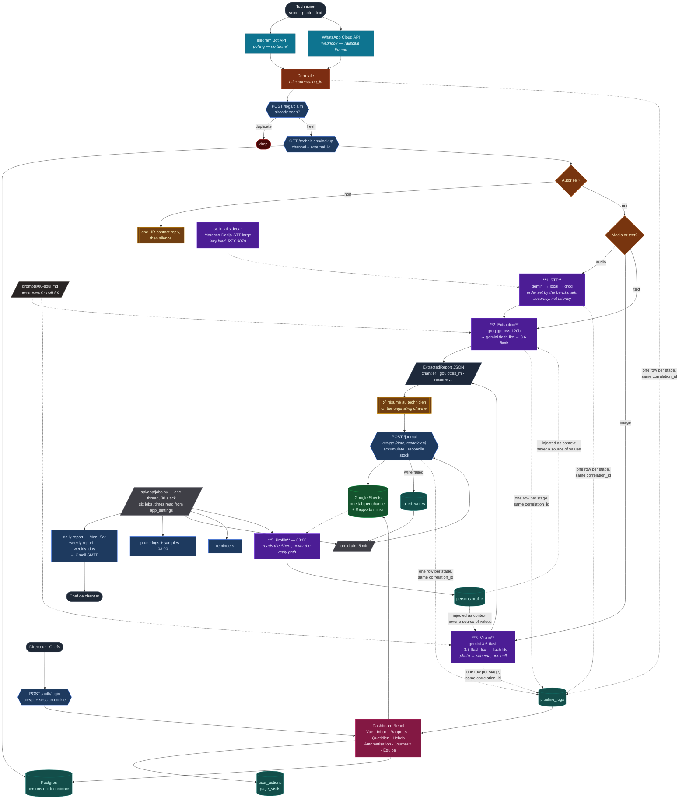

# Rapport Journalier — aznet.ma (PFE 2026)

Automated daily reporting for cabling technicians: voice note in Moroccan Darija (via Telegram) → transcription → AI extraction → professional French summary → Google Sheets → manager notification.

**Full project plan:** [PLAN.md](PLAN.md) · **Spec:** [docs/cahier-des-charges.md](docs/cahier-des-charges.md)

> **Reception channels:** the cahier des charges specifies WhatsApp Business API. The project now runs **both Telegram Bot API AND WhatsApp Cloud API** as live inputs (one n8n workflow, imported from `n8n/aznet-complete.json`). Telegram was added first (no Meta friction); WhatsApp was brought up end-to-end on 2026-07-23 (System User token, published app, WABA subscription). Reception is channel-agnostic by design: both feed the same `/process` API and the same Sheet; only the reception nodes differ per channel. A message received on a channel is replied to on that same channel.

## Architecture



Five things in that diagram are deliberate and easy to break:

1. **The reply comes before the journal write.** The append used to sit between the LLM result and the technician, so a Google outage silently swallowed the report. It is now a recoverable side effect: `POST /journal` returns 502 *and* parks the row in `failed_writes`, which is drained every 5 minutes through the same code path as the live flow — and the technician always gets their summary. The n8n node calls it with **no retry**, because the API self-parks and a retry would double-park.
2. **Access control is a table, not a literal.** `GET /technicians/lookup` reads `persons`/`technicians`, so adding a colleague in the dashboard takes effect on their next message — no workflow edit, no re-import.
3. **One person, many channels.** WhatsApp and Telegram identities point at the same `persons` row, which is what lets one profile cover both.
4. **The profile is context, never data.** It is injected into the extraction prompt explicitly labelled informational and forbidden as a source of values, and its own prompt bans numbers outright.
5. **Generation is user-triggered.** The image card fires on a click, never a cron — Google meters image models far more tightly than text.

## Repository layout

| Path | Content |
|---|---|
| `api/` | FastAPI AI service — five models (STT, text extraction, vision, image card, nightly profiles), versioned prompts in `app/prompts/`, auth + audit trail, dashboard and report endpoints |
| `Dashboard/` | React 19 + Vite + Tailwind v4 — login, metrics, inbox, reports, automation, access control, live logs, Équipe (accounts + audit). Light/dark + FR/EN/AR (RTL) from JSON locales. Replaced `web/` on 2026-07-26 |
| `n8n/` | **`aznet-complete.json` — the one file to import** (reception + error handler, two labelled bands). Everything scheduled moved to `api/app/jobs.py`; set the workflow as its own Error Workflow after import |
| `benchmark/` | Darija STT benchmark — **run 2026-08-07/08**, 13 engines over 11 real clips (`STT-BENCHMARK-STATUS.md`), plus the containerised `stt-local` GPU sidecar (`Dockerfile`, `stt_server.py`). Weights are bind-mounted, not in git: 5.8 GB, over GitHub's LFS ceiling — `download_models.py` is the versioned recipe |
| `docs/` | Cahier des charges, setup guide, audits |
| `Pres+report/` | The PFE report (`Rapport-PFE.md` → `.docx` via `build.ps1`) and the defence deck (`presentation.py` → `.pptx`). Both are generated: never hand-edit the outputs |

## Quickstart (n8n)

Requires [Docker Desktop](https://www.docker.com/products/docker-desktop/).

```bash
cp .env.example .env        # fill keys as you obtain them (see docs/setup-guide.md)
docker compose up -d        # five services
```

| Service | Published port | Notes |
|---|---|---|
| `web` (nginx) | **:8080 — the only one** | serves the dashboard and proxies `/api/ → api:8000` |
| `n8n` | :5678 | reception + error-handler workflow |
| `api` | *none* | reachable only on the compose network, through nginx |
| `postgres` | 127.0.0.1:5432 | loopback only |
| `stt-local` | *none* | GPU sidecar; needs a working `--gpus all`, or it silently runs on CPU at 60–180 s per note |

Because `api` publishes no host port, the Vite dev proxy must target **`http://127.0.0.1:8080`**, not `:8000` — and with no `rewrite`, since nginx already maps the prefix.

Three keys are required before the dashboard and the pipeline can talk to each other:

```bash
INTERNAL_API_KEY=...        # n8n sends it as X-API-Key; unset = machine access DISABLED
ADMIN_EMAIL=you@aznet.ma    # seeds the first director account, only while no `persons` row has a password_hash
ADMIN_PASSWORD=...          # min 8 characters
```

Then import `n8n/aznet-complete.json` — one import covers the reception band (Telegram + WhatsApp → `/process` → reply → Sheets) plus the error-handler band. After import, set **Settings → Error Workflow → this same workflow** (one manual step; the public API silently drops `settings` keys it does not accept, so re-check it after every push).

No Docker yet? Instant dev run: `npx n8n` (Node 20+). See `n8n/README.md` for webhook tunnel options.

## Status

- [x] Week 0: plan + scaffold
- [x] Week 0: E2E smoke test passed (Jul 17) — Telegram voice → transcription → extraction → French summary → reply, live
- [x] Sprint 2: **full dual-channel E2E** (2026-07-23) — Telegram + WhatsApp voice/text → `/process` → Google Sheets row → ✅ reply on the originating channel. Unified n8n workflow, access control + roles, dedupe, failure replies, low-confidence flagging, error-tab workflow, end-of-day report cron.
- [x] Sprint 2: **manager dashboard v1** — React (`web/`) + FastAPI `/reports` endpoints; report list, technicien/chantier/date filters, review queue on `flag_review`, confidence %, click-to-edit cells writing back to Sheets.
- [x] Sprint 2: **dashboard redesign v2** (2026-07-24) — neutral/monochrome Efferd-style app-shell (framed KPI panels, gradient bars + glowing channel step-line), light/dark theme + FR/EN/AR language switch (RTL) from JSON locales (`web/src/locales/`), 16 metrics across Activité/Production/Qualité/Cadence (incl. WoW deltas, Darija-voice share, API uptime from `/health`), per-technician summary, recent-reports/health/activity bottom row.
- [x] Sprint 2: **resilience + observability** (2026-07-25) — reply-first ordering so a Sheets outage can no longer swallow a report (failed writes park in a Postgres retry queue, drained every 5 min); durable WhatsApp idempotency (was in-memory, wiped on restart); retries + timeouts on `/process`; global error workflow wired to `POST /logs`; per-stage pipeline logging joined by `correlation_id` across n8n and the API, surfaced in a new **Logs n8n** dashboard panel (live tail, filters, 30-day retention); every workflow merged into a single importable `n8n/aznet-complete.json`.
- [x] Sprint 2: **five models + prompt library** (2026-07-27) — text/vision/image-generation chains ranked by `benchmark/run_model_benchmark.py`; prompts moved out of Python into versioned Markdown with a shared `00-soul.md` identity.
- [x] Sprint 2: **one person across channels + nightly profiles** (2026-07-29) — `persons`/`technicians` split so a colleague's memory follows them, not their phone number; the n8n allowlist now reads the table; a fifth model writes a short profile at 03:00 from their own past reports and it is injected into extraction as labelled context.
- [x] Sprint 2: **dashboard accounts** (2026-07-29) — login (bcrypt + revocable Postgres sessions), roles `directeur`/`chef`, every endpoint gated on the API, `X-API-Key` for n8n, and an audit trail (actions with before → after, time per page) in the new **Équipe** panel. New **Journaux** panel renders the live pipeline log.
- [x] Publish-readiness hardening (2026-07-30) — `cors_origins` narrowed from `*` to the Vite dev origins, `/auth/login` throttled (8 failures / 5 min per client address, honoring `trusted_proxy_hops`), sessions stored server-side.
- [x] **Durable Drive audio links + technician commands** (2026-08-04) — audio pushed to Drive for a lasting `lien_audio`; raw media and chat archived in Postgres and the Inbox rebuilt as a conversation with a reply composer; `/rapport`, `/modifier`, `/supprimer` (the last empties the row in place — a positional delete would shift every row number below it and break every stored message→row link).
- [x] **The schema rebuilt on the director's real file + the journal** (2026-08-05) — typed quantity fields per column, enum-validated locations, and the Sheet write moved from n8n into `POST /journal`: one row per (date, technicien) in that chantier's own tab, with intra-day accumulation and stock reconciliation. Merging needs a read-modify-write no IF node can express.
- [x] **Chantiers and the bordereau** (2026-08-05) — routing lives on the chef and technicians inherit it; installed quantities are computed from the journal on every call and stored nowhere, so they cannot drift.
- [x] **STT benchmark run and settled** (2026-08-07/08) — 13 engines, 3 by API and 12 locally on an RTX 3070, over 11 real clips. `stt_chain = gemini,local,groq`, ordered by accuracy judged against the audio by a native speaker. It reversed its own hypothesis twice and exposed a silent harness bug that had been crowning a winner on a transcription never generated. The dead `hf-darija` adapter was deleted.
- [x] **Rapports mirror + n8n rewire** (2026-08-09) — the field→column mapping moved out of untestable n8n expressions into Python; n8n now writes no Sheet at all.
- [x] **Local engine containerised** (`stt-local`) — weights bind-mounted rather than baked, loaded lazily on first use and lock-guarded so two notes cannot both start a 4 GB load and OOM an 8 GB card.
- [x] **CI hardened to 17 checks** — correctness, CodeQL ×2, Semgrep, Bandit, Trivy ×2, pip-audit, npm audit, gitleaks, Hadolint ×2, actionlint. Dependabot covers five ecosystems daily.
- [x] **PFE report and defence deck** (2026-08-12) — `Pres+report/`, both generated from source and checked against the EMSI writing guide.
- [ ] **Pilot**: deploy on the aznet server, register 2–3 real technicians. The one open item — the report reserves slots for its measured latency and usage numbers.

Setup walkthrough for the whole pipeline: [docs/setup-guide.md](docs/setup-guide.md).
PFE report: `Pres+report/Rapport-PFE.docx` · defence deck: `Pres+report/Soutenance-PFE.pptx`.
