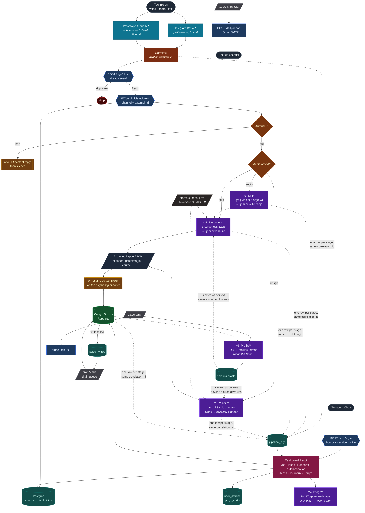

# Rapport Journalier — aznet.ma (PFE 2026)

Automated daily reporting for cabling technicians: voice note in Moroccan Darija (via Telegram) → transcription → AI extraction → professional French summary → Google Sheets → manager notification.

**Full project plan:** [PLAN.md](PLAN.md) · **Spec:** [docs/cahier-des-charges.md](docs/cahier-des-charges.md)

> **Reception channels:** the cahier des charges specifies WhatsApp Business API. The project now runs **both Telegram Bot API AND WhatsApp Cloud API** as live inputs (one n8n workflow, imported from `n8n/aznet-complete.json`). Telegram was added first (no Meta friction); WhatsApp was brought up end-to-end on 2026-07-23 (System User token, published app, WABA subscription). Reception is channel-agnostic by design: both feed the same `/process` API and the same Sheet; only the reception nodes differ per channel. A message received on a channel is replied to on that same channel.

## Architecture



Five things in that diagram are deliberate and easy to break:

1. **The reply comes before the Sheet write.** The append used to sit between the LLM result and the technician, so a Google outage silently swallowed the report. It is now a recoverable side effect: a failed write parks in `failed_writes`, is drained every 5 minutes, and the technician always gets their summary.
2. **Access control is a table, not a literal.** `GET /technicians/lookup` reads `persons`/`technicians`, so adding a colleague in the dashboard takes effect on their next message — no workflow edit, no re-import.
3. **One person, many channels.** WhatsApp and Telegram identities point at the same `persons` row, which is what lets one profile cover both.
4. **The profile is context, never data.** It is injected into the extraction prompt explicitly labelled informational and forbidden as a source of values, and its own prompt bans numbers outright.
5. **Generation is user-triggered.** The image card fires on a click, never a cron — Google meters image models far more tightly than text.

## Repository layout

| Path | Content |
|---|---|
| `api/` | FastAPI AI service — five models (STT, text extraction, vision, image card, nightly profiles), versioned prompts in `app/prompts/`, auth + audit trail, dashboard and report endpoints |
| `Dashboard/` | React 19 + Vite + Tailwind v4 — login, metrics, inbox, reports, automation, access control, live logs, Équipe (accounts + audit). Light/dark + FR/EN/AR (RTL) from JSON locales. Replaced `web/` on 2026-07-26 |
| `n8n/` | **`aznet-complete.json` — the one file to import** (reception + maintenance + daily report + error handler in four labelled bands). Per-concern sources alongside it; `legacy-*.json` are superseded single-channel flows, never activate one |
| `benchmark/` | Darija STT benchmark — dataset protocol, WER harness (Sprint 1) |
| `docs/` | Cahier des charges, installation doc, user guide |

## Quickstart (n8n)

Requires [Docker Desktop](https://www.docker.com/products/docker-desktop/).

```bash
cp .env.example .env        # fill keys as you obtain them (see docs/setup-guide.md)
docker compose up -d        # n8n :5678, API :8000, Postgres (pipeline logs) :5432
```

Three keys are required before the dashboard and the pipeline can talk to each other:

```bash
INTERNAL_API_KEY=...        # n8n sends it as X-API-Key; unset = machine access DISABLED
ADMIN_EMAIL=you@aznet.ma    # seeds the first director account, only while `users` is empty
ADMIN_PASSWORD=...          # min 8 characters
```

Then import `n8n/aznet-complete.json` — one import covers all four workflows.

No Docker yet? Instant dev run: `npx n8n` (Node 20+). See `n8n/README.md` for webhook tunnel options.

## Status

- [x] Week 0: plan + scaffold
- [x] Week 0: E2E smoke test passed (Jul 17) — Telegram voice → transcription → extraction → French summary → reply, live
- [x] Sprint 2: **full dual-channel E2E** (2026-07-23) — Telegram + WhatsApp voice/text → `/process` → Google Sheets row → ✅ reply on the originating channel. Unified n8n workflow, access control + roles, dedupe, failure replies, low-confidence flagging, error-tab workflow, end-of-day report cron.
- [x] Sprint 2: **manager dashboard v1** — React (`web/`) + FastAPI `/reports` endpoints; report list, technicien/chantier/date filters, review queue on `flag_review`, confidence %, click-to-edit cells writing back to Sheets.
- [x] Sprint 2: **dashboard redesign v2** (2026-07-24) — neutral/monochrome Efferd-style app-shell (framed KPI panels, gradient bars + glowing channel step-line), light/dark theme + FR/EN/AR language switch (RTL) from JSON locales (`web/src/locales/`), 16 metrics across Activité/Production/Qualité/Cadence (incl. WoW deltas, Darija-voice share, API uptime from `/health`), per-technician summary, recent-reports/health/activity bottom row.
- [x] Sprint 2: **resilience + observability** (2026-07-25) — reply-first ordering so a Sheets outage can no longer swallow a report (failed writes park in a Postgres retry queue, drained every 5 min); durable WhatsApp idempotency (was in-memory, wiped on restart); retries + timeouts on `/process`; global error workflow wired to `POST /logs`; per-stage pipeline logging joined by `correlation_id` across n8n and the API, surfaced in a new **Logs n8n** dashboard panel (live tail, filters, 30-day retention); all four workflows merged into a single importable `n8n/aznet-complete.json`.
- [x] Sprint 2: **five models + prompt library** (2026-07-27) — text/vision/image-generation chains ranked by `benchmark/run_model_benchmark.py`; prompts moved out of Python into versioned Markdown with a shared `00-soul.md` identity.
- [x] Sprint 2: **one person across channels + nightly profiles** (2026-07-29) — `persons`/`technicians` split so a colleague's memory follows them, not their phone number; the n8n allowlist now reads the table; a fifth model writes a short profile at 03:00 from their own past reports and it is injected into extraction as labelled context.
- [x] Sprint 2: **dashboard accounts** (2026-07-29) — login (bcrypt + revocable Postgres sessions), roles `directeur`/`chef`, every endpoint gated on the API, `X-API-Key` for n8n, and an audit trail (actions with before → after, time per page) in the new **Équipe** panel. New **Journaux** panel renders the live pipeline log.
- [ ] Before publishing the dashboard: narrow `allow_origins`, rate-limit `/auth/login`
- [ ] STT benchmark → pick default provider (`benchmark/`)
- [ ] Durable Drive audio links, `/rapport` boss command
- [ ] Sprint 3: pilot + docs + PFE report

Setup walkthrough for the whole pipeline: [docs/setup-guide.md](docs/setup-guide.md).
Draft PFE report: `Pres+report/Rapport-PFE.docx`.
