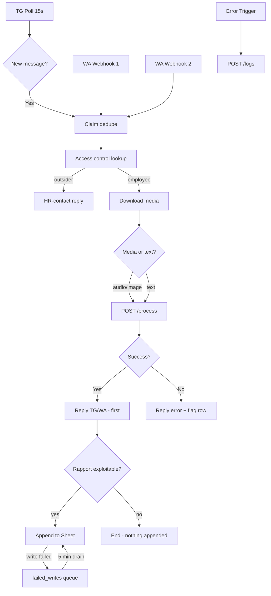

# n8n Workflows

> **Last workflow update:** 2026-07-29 — see `n8n/README.md` for the exact changelog.

## Source of Truth

Single unified workflow: **`n8n/aznet-complete.json`** — **reception + error handler** since 2026-07-29 (the maintenance and daily/weekly report bands moved into the API's own scheduler, `api/app/jobs.py`, so the dashboard can show what ran and re-run it).

Legacy workflows (`n8n/legacy-*.json`) are kept for reference only. Never import them alongside the unified flow — they overlap on triggers, Sheet appends, and Telegram nodes.

## Unified Workflow Structure

One file, two labelled bands, one Telegram polling trigger:



### Band breakdown

| Band | Triggers | Nodes | Purpose |
|---|---|---|---|
| **Réception** | TG Poll (15s) + 2 WA Webhooks | 10+ | Main path: dedupe → access control → download → `/process` → reply → Sheet |
| **Erreurs** | Error Trigger | 1 | Any unhandled crash → `POST /logs` |

The maintenance (drain, prune) and daily/weekly report bands are handled by `api/app/jobs.py` — see [[architecture]] §Scheduled jobs.

**Trigger details:**
- **Telegram:** Polling (`getUpdates` every 15 seconds), outbound-only (no open ports). TG Trigger node configured with the bot token
- **WhatsApp:** Two Webhook nodes (message + status updates) at the shared URL `https://<TAILSCALE_HOSTNAME>/webhook/whatsapp/receive`
- **Error:** Error Trigger node links to this workflow. Requires one manual setup step: **Settings → Error Workflow → select this same workflow** — and it must be re-checked after every import or API push, because it lives in the workflow's `settings` and the public API silently drops keys it does not accept. Otherwise the Error Trigger never fires.

### Key design decisions (n8n layer)

1. **Reply-first ordering.** Reply to the technician (N8s_Reply_TG / Reply_WA) happens **before** the Sheet append (N9_Append_Success). A failed write must never cost the user their confirmation.
2. **Error row flagging.** When `/process` returns 502, the workflow continues to N10_Append_Flag (writing whatever it can with `Statut: error`). The technician gets "Une erreur est survenue, l'équipe technique va vérifier."
3. **WhatsApp media download** uses a plain HTTP GET node with the token in the Authorization header — n8n's native WhatsApp download node returns "Bad request" for voice notes.
4. **Channel-agnostic payload.** Both TG and WA paths produce the same shape for `/process`. The originating channel is inferred from `correlation_id` prefix (`tg-` vs `wa-`) or metadata.

## Channel Asymmetry

Important when debugging:

- **Telegram errors but WhatsApp is silent**: an error reply proves the message reached the pipeline. Silence means it never arrived at n8n (wrong webhook URL, Meta not subscribed, tunnel down).
- **WhatsApp works but Telegram is silent**: the polling trigger may have hit a rate limit or the bot was blocked.
- The public URL is a **Tailscale Funnel** — a stable hostname (`https://<TAILSCALE_HOSTNAME>` → `127.0.0.1:5678`). Meta's webhook is configured once and survives reboots.

## Data Contract

The API's response is destructured and mapped to Sheet columns via n8n's "Set" node before the Google Sheets append.

## Environment Variables Required by n8n

```
TELEGRAM_BOT_TOKEN=...
GROQ_API_KEY=...
GEMINI_API_KEY=...
INTERNAL_API_KEY=...              # Sent as X-API-Key header to the API
WHATSAPP_VERIFY_TOKEN=...
WHATSAPP_TOKEN=...                 # Permanent System User token (never expires)
API_BASE_URL=http://localhost:8000 # or host.docker.internal:8000 in Docker
```

In Docker, `API_BASE_URL` points to `host.docker.internal:8000` (the host machine's API).

## Related
- [[architecture]] — data flow diagram
- [[Deployment Guide]] — Docker setup
- [[Google Sheets Integration]] — Sheet mapping
- [[Project Overview]] — why hybrid architecture
